# architecture.md — Sandeel Farms V242 (Local Preview) — Reverse-Engineered Architecture

> **Source of truth for this document:** `index.html` (title *"Sandeel Farms V242 — Local Preview"*), 15,175 lines, ~1.69 MB, read end-to-end.
> **Audience:** Cursor AI and the developer who will turn this single-file prototype into a production system.
> **Status of this document:** descriptive (what the file does today) + prescriptive (clearly marked *Proposed*) — never mixed.

---

## Table of contents

1. [Document Overview](#1-document-overview)
2. [Executive Summary](#2-executive-summary)
3. [Technology & Dependency Inventory](#3-technology--dependency-inventory)
4. [Module Inventory](#4-module-inventory)
5. [UI & Navigation](#5-ui--navigation)
6. [Screen-by-Screen Specification](#6-screen-by-screen-specification)
7. [Entity Inventory (as found in source)](#7-entity-inventory-as-found-in-source)
8. [Proposed Relational Database (PostgreSQL)](#8-proposed-relational-database-postgresql)
9. [Data Lineage](#9-data-lineage)
10. [Business Rules Catalogue](#10-business-rules-catalogue)
11. [Backend API](#11-backend-api)
12. [Frontend–Backend Integration](#12-frontendbackend-integration)
13. [Authentication, Roles & Permissions](#13-authentication-roles--permissions)
14. [State & Persistence](#14-state--persistence)
15. [Import, Export, Reporting & Printing](#15-import-export-reporting--printing)
16. [Validation, Error Handling & Reliability](#16-validation-error-handling--reliability)
17. [Security, Privacy & Audit](#17-security-privacy--audit)
18. [Non-Functional Requirements](#18-non-functional-requirements)
19. [Existing App Integration & Code Mapping](#19-existing-app-integration--code-mapping)
20. [Testing Strategy](#20-testing-strategy)
21. [Implementation Roadmap](#21-implementation-roadmap)
22. [Traceability Matrix](#22-traceability-matrix)
23. [Open Questions & Architecture Decision Records](#23-open-questions--architecture-decision-records)
24. [Cursor AI Operating Instructions](#24-cursor-ai-operating-instructions)
25. [Appendix A — Self-audit](#appendix-a--self-audit)

---

## 1. Document Overview

### 1.1 Purpose
Reverse-engineer the single-file web application `index.html` (Sandeel Farms — a goat farm management system for a farm in Punjab, Pakistan) into a complete architecture reference that an AI coding assistant (Cursor) can follow to:

- understand exactly what the current file does, where, and how;
- design the production backend (database, API, auth, sync) **without inventing features that do not exist** and without silently changing business rules;
- see every defect, inconsistency, and gap documented with a line reference, so fixes are deliberate.

### 1.2 Scope
| In scope | Out of scope |
|---|---|
| Every `<style>`, markup block and `<script>` in `index.html` (lines 1–15,175) | Changing `index.html` (this document does **not** modify it) |
| Behaviour observable in the source and confirmed by one headless browser load (Playwright, Chromium) | Server code — none is present in the supplied file |
| Proposed DB/API/auth design (clearly labelled *Proposed*) and a reading of the claude.ai project notes about the production package (labelled *Reported*) | Deployment (explicitly not done) |

### 1.3 Method
1. A copy of the file was made with the five base64 JPEG images (lines 1449, 1454, 1460, 2920, 2941) replaced by a placeholder so **line numbers stay identical** to the original.
2. The file was read sequentially in chunks; findings were logged with line numbers.
3. Supporting scans: function inventory (713 named function declarations, 693 unique names), `fetch(` calls, external URLs, browser APIs, element-ID existence checks for legacy renderers.
4. One runtime probe (Playwright): page load produced **0 uncaught page errors**; confirmed `window.farm`, `window.SFStock`, `window.SFTrade` exist, `window.SandeelCloud` is `undefined`, `window.SANDEEL_DEMO === true`, `window.SANDEEL_AI_ENDPOINT === "/api/ai"`, `typeof st === "undefined"` (see defect DEF-01).

### 1.4 Evidence classification (used throughout)
| Tag | Meaning |
|---|---|
| **[Implemented]** | Working code path exists in `index.html` and is reachable from the UI or the public JS API. |
| **[Partial]** | Code exists but is incomplete, inconsistent, or has a documented defect. |
| **[Mock/Demo]** | Exists only for the local preview (seed data, `SANDEEL_DEMO`, demo banner, owner/owner login). |
| **[Proposed]** | Recommendation of this document. **Does not exist in the source.** |
| **[Unknown]** | Referenced by the source but the implementation is not in the supplied file (e.g. `window.SandeelCloud`, `/api/ai` server). |
| **[Reported]** | Stated in the claude.ai project notes about the production package (V232/V242), not verifiable from `index.html`. |

### 1.5 Line-reference convention
`L5397` = line 5397 of `index.html`. `L13284–13585` = inclusive range. Function names are given as `can()` etc. When a function is redefined/wrapped later, both locations are given.

### 1.6 Glossary (domain)
| Term | Meaning in this app |
|---|---|
| Doe / Buck / Kid | Female adult / male breeding goat / young goat |
| Cross | Mating (stored as `goat.matedDate` + `goat.buck`) |
| Scan | Pregnancy ultrasound (`usDate`, `kids` = expected count) |
| Kidding | Birth event (`kiddings[]`) |
| Dry off | Stop milking before kidding |
| Batch (season) | Breeding season window (`season.batches`, e.g. Sept, Spring) |
| Maund (mann) | 40 kg (Trading module, voice parser) |
| Godown | Warehouse (Trading module) |
| Kiraya | Freight / transport cost |
| Bhoosa | Straw (Trading item "Moongphali bhoosa" = groundnut straw) |
| CIP | Capital work in progress (Projects) |
| COGS | Cost of goods sold (stock ledger weighted average) |

---

## 2. Executive Summary

**What it is.** A single-page, single-file (HTML+CSS+JS, no build step, no framework) farm ERP for a goat farm: herd & pedigree, breeding season planning, feed rations & feed store, milk → pasteurisation → dairy products, slaughter → carcass → cuts, product sales with invoices and receivables, a separate **Trading** business (buy & resell straw), full farm accounting (cash/bank accounts, P&L, cash flow, balance sheet, payables/receivables, payroll, owner funding, profit sharing), capital projects, vaccines/health, tasks, reports, users/roles/permissions, audit log, backup/restore, and an AI/voice assistant (Urdu/Punjabi/English) wired to a not-included `/api/ai` server.

**How it is built.**
- All state is held in ~80 global JS variables and persisted as **one JSON document** (key `goatHerd_v4`) to IndexedDB (`sandeelFarms`/`kv`) with a `localStorage` mirror (L5260–5280, L5556–5568). Every save rewrites the whole document.
- Rendering is imperative `innerHTML` string building; navigation is `goView(view)` toggling `.view` sections (L9741) — no router, no URL state.
- The file grew by **versioned add-on blocks** (`v111`…`v242`): later scripts *wrap* earlier functions by reassignment (e.g. `renderFinance`, `renderBankCash`, `goView`, `hideLogin`) and add capture-phase global click guards (v194 double-entry guard, v196 safe-delete).
- Two subsystems are internally well-structured and should be preserved as the domain core: **V232 Stock Ledger** `window.SFStock` (signed operation lines, weighted average cost, idempotent `sourceKey`, reversals — L13284–13585) and **V235 Trading** `window.SFTrade` (event-sourced books recomputed from entries — L14663–15173).

**Maturity verdict.**
| Area | Verdict |
|---|---|
| Domain coverage | Very broad and farm-specific (Pakistani units, Urdu vocabulary, local practices). |
| Data integrity | Good inside SFStock / SFTrade; weak elsewhere (several accounting engines disagree, see §10.9). |
| Security | Client-side only. Permissions are enforced in JS and many handlers skip `can()` (§13.6). Not a security boundary. |
| Multi-device | Not implemented in this file. Hooks to an absent `window.SandeelCloud` client exist (L5565, L8060, L13148). V242 adds device codes in document numbers and duplicate-entry warnings. |
| Backend | **None in the file.** Only 6 network call sites exist (§11.1), all to endpoints whose servers are not supplied. Project notes (not code) report an ASP.NET Core + PostgreSQL production backend and a cloud build of this same HTML (§19.1) — **[Reported, unverified]**. |

**Key recommendation.** Do **not** rewrite. Verify the reported production repository first (§19), then extend it: server-side authorization for every synced mutation, a server-side stock check, one finance engine, idempotent writes keyed by client IDs, and deliberate fixes of the documented defects (§21). Keep the SFStock and SFTrade algorithms as the domain core. The relational model in §8 is a reference target for gap analysis, not a replacement schema.

### 2.1 System architecture (as found)
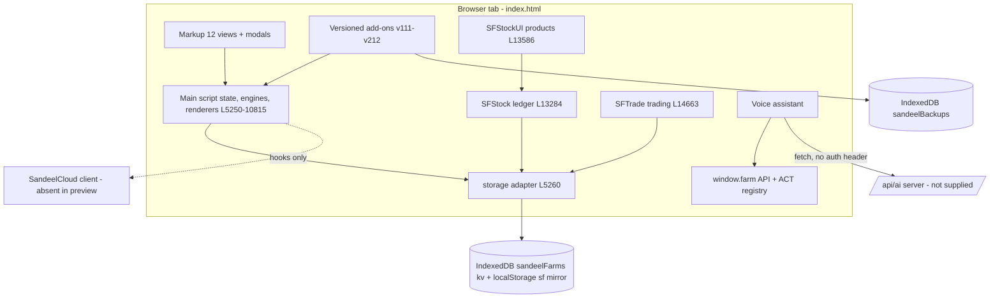

**Counts (established from source).**
| Item | Count | Basis |
|---|---|---|
| Top-level views (`.view` sections) | 12 | runtime probe + markup (L2987–5126) |
| Permission modules (`MODULES`) | 13 | L5367 |
| Role templates | 8 | L5367–5381 |
| Persisted top-level keys in `goatHerd_v4` | 85 | `save()` L5561 |
| Named function declarations | 713 (693 unique) | static scan |
| Network call sites (`fetch`) | 6 | L8424, L8435, L11052, L11785, L11957, L12214 |
| AI write actions (`ACT` registry) | 32 | L11136–11636 |
| Stock operation types | 12 | `OP_LABEL` L13284+ |

---

## 3. Technology & Dependency Inventory

### 3.1 Runtime stack
| Layer | Technology | Evidence | Status |
|---|---|---|---|
| Markup | HTML5, one file | L1–15175 | [Implemented] |
| Styling | Hand-written CSS: base block L15–833 + ~60 versioned `<style id="vNNN">` blocks to L2864; more inline style blocks in add-ons (L10926, L10981, L11637, L12576–12667, L12934, L13264) | head | [Implemented] |
| Font | Google Fonts **Inter** (only external resource) | head `<link>` | [Implemented] |
| Images | 5 inline base64 JPEGs (background/logo) | L1449, L1454, L1460, L2920, L2941 | [Implemented] |
| Script | Vanilla ES2017+ (async/await, arrow functions, `Map`, `Set`, template literals), no modules, no bundler | L5250–15173 | [Implemented] |
| Charts | Hand-rolled SVG: `svgSpark`, `svgDonut`, `svgLines` | L8340–8381 | [Implemented] |
| Storage | IndexedDB `sandeelFarms` store `kv` + `localStorage` mirror (`sf:` prefix); uses host `window.storage` if present | L5260–5281 | [Implemented] |
| Backups | IndexedDB `sandeelBackups` store `snaps` | L11014–11135 | [Implemented] |
| Crypto | Web Crypto `crypto.subtle.digest('SHA-256')`, `crypto.getRandomValues` | L5442 | [Implemented] |
| Speech | Web Speech API (`SpeechRecognition`), `speechSynthesis` | L11687+ | [Implemented] (browser-dependent) |
| AI | `fetch('/api/ai')` using Anthropic Messages `tool_use`/`tool_result` shape | L12204–12296 | [Unknown] server |
| Cloud sync | `window.SandeelCloud` (login, logout, token, pullDelta, flushQueue, syncApprovals, checkHealth, persistChanges, status) | L5565, L8060, L8180, L8424, L13148 | [Unknown] — object absent |

### 3.2 Third-party libraries
**None.** No CDN scripts, no npm packages. (Verified: the only external URL is Google Fonts.)

### 3.3 Browser APIs used
`indexedDB`, `localStorage`, `sessionStorage` (`bkSnooze`), `navigator.storage.persist()`, `crypto.subtle`, `crypto.getRandomValues`, `Blob` + `URL.createObjectURL` (downloads), `FileReader` (import), `window.print()`, `MutationObserver` (v196, v212), `SpeechRecognition`/`webkitSpeechRecognition`, `speechSynthesis`, `fetch`, `setInterval` (v161 backups every 6 h, v211 sync loop every 8 s), `visibilitychange`, `online` events.

### 3.4 Global configuration flags
| Flag | Value in file | Line | Effect |
|---|---|---|---|
| `window.SANDEEL_DEMO` | `true` | L12933 | Disables offline sensitive-op gate in `can()` (L5397) and `lastOnlineAuth`/24 h grace/clock-tamper checks in `doLogin()` (L8060). **[Mock/Demo]** |
| `window.SANDEEL_AI_ENDPOINT` | `'/api/ai'` | L11687 | AI brain endpoint (hard-coded). |
| `window.SANDEEL_TTS_ENDPOINT` | not set | L11779 | Falls back to AI endpoint with `/api/ai` → `/api/speech`. |
| `window.SANDEEL_BACKUP_ENDPOINT` | empty/undefined | L11052 | Optional server backup POST. |
| `KEY` | `'goatHerd_v4'` | L5288 | Main persistence key. |

### 3.5 Code layout map
| Lines | Block | Notes |
|---|---|---|
| 1–14 | doctype/head start | |
| 15–833 | base CSS | |
| 834–2864 | ~60 versioned CSS blocks | many override each other (e.g. v173 → v178) |
| 2866–5249 | static markup: modals, login, sidebar, topbar, 12 views | |
| 5250–10815 | **main script** (state, engines, renderers, handlers, boot) | boot at L10810 |
| 10816–10925 | v111/v112/v117/v125/V151 add-ons | |
| 10926–11013 | v159 quick actions, v160 responsive CSS | |
| 11014–11135 | v161 auto backup | |
| 11136–12379 | v163 AI/voice API + voice assistant UI | |
| 12380–12575 | v168/v169/v171/v172 accounting add-ons | |
| 12576–12682 | v173/v178/v179 CSS | |
| 12683–12773 | v183 Kid Milk Diet | |
| 12774–12794 | v192 meat/animal lifetime cost engine | |
| 12795–12932 | v194 double-entry guard, v196 safe delete + integrity | |
| 12933 | `SANDEEL_DEMO=true` | |
| 12934–13205 | v205 CSS, v206 breeding groups, v210 feeding groups, v211 season months + sync loop, conflict modal | |
| 13206–13256 | v212 breed performance | |
| 13257 | demo banner | [Mock/Demo] |
| 13264–13283 | v217–v225 CSS | |
| 13284–13585 | **V232 Stock Ledger `window.SFStock`** | |
| 13586–14662 | **V232 Products UI `window.SFStockUI`** (+ V242 duplicate alerts L14622–14646) | |
| 14663–15173 | **V235 Trading `window.SFTrade`** | |

---

## 4. Module Inventory

Modules correspond to the 13 permission modules in `MODULES` (L5367) plus cross-cutting subsystems.

| # | Module (perm key) | View id | Purpose | Main code | Status |
|---|---|---|---|---|---|
| M1 | Dashboard (`dash`) | `view-dash` | Today's work, KPIs + sparklines, alerts, quick actions, approvals, recent activity | `renderDash` L8471, `renderTodayWork` L8382, v159 L10926, v168 money panel L12380 | [Implemented] |
| M2 | Herd (`herd`) | `view-herd` | Goat register, filters/chips, bulk moves, goat card (actions), pedigree, CSV import, tagging | L5816–5940, L8878–9314, L9836–9975, L10557–10643 | [Implemented] |
| M3 | Breeding (`breed`) | `view-breed` | 4-stage pipeline, season plan, heats, buck workload, breeding groups (v206), inbreeding check | L8640–8877, L9315–9679, L12992–13096 | [Partial] (DEF-01) |
| M4 | Products (`milk`) | `view-milk` | Milking sessions, tanks, pasteurise, dairy make, spoilage, slaughter/split/cut, product sales, stock & ledger, transport, costing, pricing, catalog, breed performance | L6873–6938, L10266–10332, V232 L13284–14662, v212 L13206 | [Implemented] + legacy dead renderers |
| M5 | Feed (`feed`) | `view-feed` | Feed store, purchases, recipes, group plans, fodder pool, order list, stock check, auto daily deduction, kid milk diet (v183), feeding groups (v210), season months (v211) | L5700–5815, L5941–7097, L9976–10019, L10650–10708, L12683–12773, L13097–13182 | [Implemented] |
| M6 | Trading (`trade`) | `view-trade` | Separate buy-&-resell business with own cash/bank, godowns, suppliers/customers, P&L, balance sheet | L14663–15173 | [Implemented] |
| M7 | Health (`health`) | `view-health` | Vaccine schedule, due/upcoming, give vaccine, reminders, vaccine purchases; treatments via goat card | L6739–6872, L10208–10265, goat actions L8878+ | [Implemented] |
| M8 | Finance (`finance`) | `view-finance` | Income/expense, sales & receivables, payables, P&L, cash flow, balance sheet, budget, capital & funding, profit share, salaries, fixed costs, control center, monthly closing, integrity check | L6127–6738, L10154–10207, L10425–10547, L12380–12575, L12795–12932 | [Partial] (engine inconsistencies §10.9) |
| M9 | Bank & Cash (`bank`) | Finance › Bank tab | Money accounts, deposits/withdrawals/transfers, linked postings, opening-balance lock | L6391–6498, L10503–10547, v168 L12380 | [Implemented] |
| M10 | Projects (`projects`) | `view-projects` | Capital projects, capex, CIP, fixed assets, capitalisation, solar log | L7098–7128, L10020–10065 | [Implemented] |
| M11 | Reports (`reports`) | `view-reports` | 16 report tabs, CSV, print | L7129–8043, L10066–10153 | [Partial] (legacy engines) |
| M12 | Tasks (`tasks`) | `view-tasks` | Task board, assignment, reminders | L9680–9715, L8454 | [Implemented] |
| M13 | Admin (`admin`) | `view-admin` | Users, roles, permission matrix, profile/password, audit log, notifications, security note | L8045–8339, L9785–9830 | [Implemented] (client-side only) |
| X1 | Auth & session | `#loginWrap` | Login, remembered session, first-user bootstrap | L8045–8187, L10810 | [Partial] |
| X2 | Approvals | Dashboard panel | One-time approvals (30 min) by Super admin | L8407–8453, L5392, L5430 | [Implemented] (local) |
| X3 | Backup & restore | `#backupModal` | JSON export/import, CSV exports, weekly auto-backup | L10333–10415, L11014–11135 | [Implemented] |
| X4 | Public JS API `window.farm` | — | Read/write API used by AI | L10709–10809, L11136–11636 | [Implemented] |
| X5 | Voice/AI assistant | `#vaFab`, `#vaPanel` | Urdu/English voice & chat, tool-calling, confirm/undo | L11637–12379 | [Implemented] client; [Unknown] server |
| X6 | Stock ledger `SFStock` | — | Inventory engine for milk/dairy/meat | L13284–13585 | [Implemented] |
| X7 | Cloud sync | `#conflictModal` | Hooks only | L13148–13205 | [Unknown] |

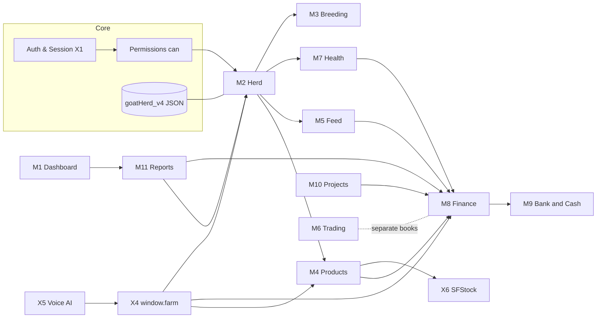

---

## 5. UI & Navigation

### 5.1 Shell
- **Login overlay** `#loginWrap` (L2918) shown by `showLogin()`; hidden by `hideLogin()` (both wrapped by v161 L11014+ and voice FAB L12370).
- **Sidebar** `#side` / `#nav` (L2943): `.nav-i[data-view]` buttons; footer: Backup Center `#backupCenterBtn`, CSV import `#csvBtn`.
- **Top bar** (L2966): menu toggle `#menuBtn` (≤980 px), scan box `#scanAll`/`#scanGo`, date `#topDate` (hard-coded location text "Sargodha, Pakistan", L9831 — farm is in Toba Tek Singh per project brief → Open Question OQ-12), bell `#bellBtn`, hidden conflict button `#conflictNavBtn`, user chip and logout.
- **Page head** `#pageIco #pageTitle #pageSub #pageAct` — filled from `PAGE` map (L9716) by `goView()`.
- **Modals**: `#backupModal` (L2867), `#goatModal` (L2899), `#askModal` generic form (L2908, `ask()` L5672), `#td-dlg` (Trading add/edit), `#conflictModal` (L13183, inert), voice panel `#vaPanel`.

### 5.2 Navigation graph (top level)
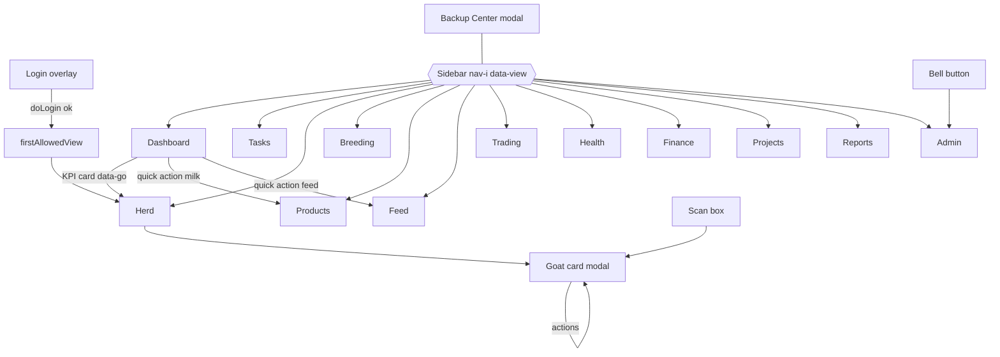

### 5.3 Sub-navigation (tabs) — split for readability
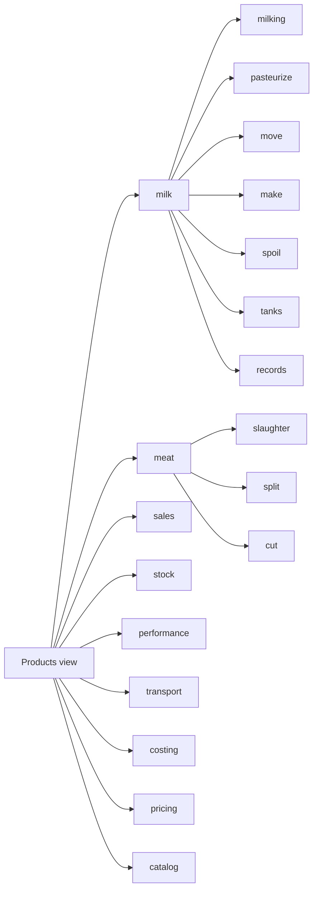
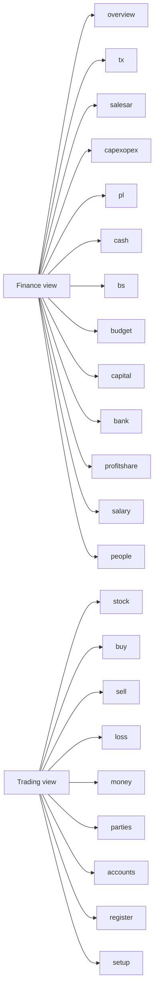
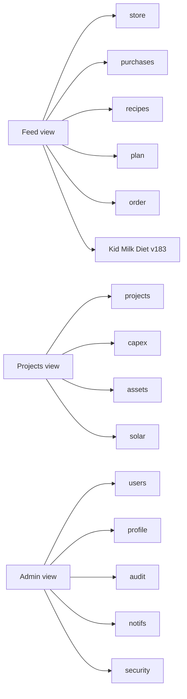
Reports tabs (`data-reptab`, L4686): dash, herd, breeding, growth, feed, health, finance, capexopex, profit, profitshare, inventory, projects, logistics, alerts, owners, compare.

### 5.4 Navigation edges table
| From | Trigger (DOM) | To | Code | Guard |
|---|---|---|---|---|
| Login | `#lg-go` / Enter | `firstAllowedView()` | `doLogin` L8060, L8185 | credentials |
| Any | `.nav-i[data-view]` | view | `goView` L9741 (wrapped v161) | `can(v,'view')` else fallback |
| Any | `#bellBtn` | Admin › notifs | L9762+ | `admin:view` (bell hidden otherwise) |
| Any | `#scanGo` / Enter | Goat card or tag-kid flow or Add goat | `scanOpen` L10557 | none |
| Dashboard | KPI card `[data-go]` | Herd with filter | `renderDash` L8471 | herd:view |
| Dashboard | Quick action | Products milking / Feed / Finance / Bank | `runPageAction` L9716 | per-action `can()` |
| Herd row | `[data-goatcard]` | Goat modal | L9200 | none |
| Goat card | nested goat links | Goat modal (other goat) | `showGoatCard` L9149 | none |
| Page head | `#pageAct` | module action (add goat, milk, feed buy, vaccine, cost, project, csv, trade buy) | `runPageAction` | per-action |
| Products tabs | `.prod-tab[data-ptab]` | pane | L10266, `goTab` L14499 | milk:view |
| Products | `[data-sl-open]`, `[data-sl-sell]`, `[data-sl-action]` | form within pane | `openForm` L14500, `openSale` L14526 | create perms at save |
| Trading | `[data-td-tab]` | pane | `setTab` L14803 | trade:view |
| Party row | `[data-td-settle]` | Money tab prefilled | L15152 | trade:create |
| Finance tabs | `[data-fintab]` | pane | `switchFinanceTab` L10469 | bank tab: bank:view |
| Reports tabs | `[data-reptab]` | pane | L10066 `REPNEED` | per tab |

### 5.5 Back-navigation & deep links
- **No URL routing, no `history.pushState`, no hash routes.** Browser Back leaves the app. Refresh returns to `firstAllowedView()` (Herd by default, `.view.active` in markup L3175).
- Sub-tab state persisted in `localStorage` only for: Products milk sub-pane & milking mode (`sf232:` prefix), Trading tab / money type / rate basis / statement party (`sftd:` prefix, L14683), voice language/mute.
- Modals close via close button, backdrop click (goat modal L10644, trading dialog L15145) and Escape (trading dialog L15146).
- **[Proposed]** Hash routes `#/view/tab/sub?filter=` so Back works and links can be shared.

---

## 6. Screen-by-Screen Specification

Format: **Purpose · Inputs · Actions (permission) · Outputs/Side-effects · Code · Status/Notes.**

### 6.1 Login (`#loginWrap`, L2918)
- Inputs: `#lg-user`, `#lg-pass`, `#lg-show`, `#lg-remember`.
- Action: `#lg-go` → `doLogin()` L8060. Username lower-cased. Offline: SHA-256(`salt:pw`) compare (L8166). Remember → `localStorage.goatSession` = user id (no expiry).
- First run: `ensureFirstUser()` (L8045) creates `owner/owner`, role Super admin, `mustChange:true`. **[Mock/Demo] must not ship.**
- Note text says the login "is not data encryption".

### 6.2 Dashboard (`view-dash`, L3063)
- Hero `#heroHi #heroMeta` (milk today from legacy `milkProd`).
- `#dashCards` KPI cards with 6-month sparklines (herd size at month end, milk, births, money in if `finance:view`) — L8471.
- Today at the farm `#todaySmartStats #todayWorkList` — `renderTodayWork` L8382 (scans due, births ≤14 d, treatments, feeds <14 days cover).
- Tasks panel `#dashTaskPanel` — L8454; Start/Done require `tasks:edit`.
- Donut (Does/Bucks/Kids/For sale), 12-month breeding chart, alerts (top 8 of `buildAlerts` L7399), quick actions (v159 panel), approval center `#approvalCenterPanel` (L8439), this-month money table `#dashMonthRows` (legacy engine — see BR-FIN-20), recent goats, recent activity (eventLog; sale/purchase hidden without finance:view).
- v161 backup reminder banner for `admin:edit` users (L11014+); v168 Cash & Bank panel `#v168MoneyPanel`.

### 6.3 Tasks (`view-tasks`, L3148)
- Form: title, assignee (user or "all"), due, priority (Normal/High/Urgent), type (Task/Reminder), note. `#addTask` needs `tasks:create`.
- Filters all/mine/urgent/reminder, person. Kanban columns todo/doing/done.
- Delete needs `tasks:del`; status change needs `tasks:edit` (assignees without edit cannot complete their own task — OQ-07).

### 6.4 Herd (`view-herd`, L3175–3289)
- Add goat panel: tag*, name, breed, gender, owner, health, source (bought/born), price, status, date*, sire, dam, note → `#addBtn` (markup `data-needs="herd:create"`; handler L9836 has **no `can()`** — GAP-P01). Tag uniqueness checked only among live goats (`findGoatByTag` L9945 — DEF-05).
- Treatments panel (open treatments, withdrawal days, Recovered button — no `can()`, L5880).
- Filter `#filter` (age, status, untagged, wean, ageup, heatdue, dryoff, buildup, stopmilk, crossdue, breeding stages, health/batch/sire/owner/group), chips `#herdChips` (L5842), mobile filter toggle (v112).
- Table `#rows` (L5924) with checkbox selection; bulk "Move to" `#moveTo` + `#moveBtn` (L9861, **no `can()`** — GAP-P02): status, breeding actions (prep/cross/born/plan/dryoff), batch, kid actions (wean/class/graduate), health, owner, group, feeding group (v210).
- Goat card (product: `#goatModal` + `#askModal` in `_GoatCardModals.cshtml`, `goat-card.js`; prototype `showGoatCard` L9149): global `[data-goatcard]` / Herd Tree opens modal; `GET /Goat/Card` or `/Search/Lookup`; header, kid stage line, family tree (3–5 generations SVG), siblings, kidding table / sire stats, weights, note, edit parents; actions mirror `renderCardActions` L9101 (`FarmPerms` + archived read-only): weigh, BCS, status, wean, young class, graduate, tag, dry off, treat, recover, vaccinate, heat, plan cross, prep, cross, kidding, scan, returned to heat, sell, death. **Deferred:** pedigree-only ancestor sand boxes (prototype L8777–8784).
- CSV import `#csvBtn` → `importHerdCsv` L10582.

### 6.5 Breeding (`view-breed`, L3291)
- KPIs (expecting, next, prep, waiting). Pipeline: prep → cross → scan (45–60 d) → confirmed.
- Breeding groups (v206, L12992): buck, start date, max per buck (default 15), candidate picker, create (`breed:create`), cards (remove member/close needs `breed:edit`, delete needs `breed:del` and no results).
- "What needs doing now" `#nowList` (L9460); season plan editor `#seasonRows` (batch select/rename/add/delete; **no `can()`** L9384 — GAP-P05); year table; plan rows; breeding table `#brRows` with per-row action select `[data-bract]` (L9585, **no `can()`**, **DEF-01: "Entered by mistake" throws a ReferenceError for every stage**); heat table with "Seen today"; buck workload; add doe to pipeline `#addCross` (no `can()`); empty list; ration rows.

### 6.6 Products (`view-milk`, L3660–4079) — V232 UI is authoritative
| Tab / sub | Inputs | Save action (perm) | Effect | Code |
|---|---|---|---|---|
| Milk › milking | date, session, raw tank; mode breed/goat/total; rows of goats/total/rejected; note | `#sl-mg-save` (milk:create) | `milkingSessions` + `milkProd` rows + receipt op `session:<id>` | `saveMilking` L13766 |
| Milk › pasteurize | src raw tank, in L, out L, dst past tank, temps, ref, cost+account, **QC checkbox** | `#sl-pz-save` (milk:create) | op `pasteurize` + expense "Milk processing" | `savePasteurize` |
| Milk › move | from, qty, to (same kind) | `#sl-mvm-save` | op `transfer` | `saveMoveMilk` |
| Milk › make | src tank, in L, product, out qty, store, expiry, heat, costs | `#sl-mk-save` | op `make` + expenses | `saveMake` |
| Milk › spoil | item, direction, qty, reason, note | `#sl-sp2-save` | op `adjust` | `saveSpoil` |
| Milk › tanks | name, capacity, target °C, site | save (milk:edit or create) | `warehouses` | `renderTankAdmin`/`saveTank` |
| Milk › records | — | delete session (milk:del or edit) | reverse op | `deleteSession` |
| Meat › slaughter | date, tag, live kg, carcass kg, store, animal cost (auto v192), fee, labour, other, account, remove-from-herd | `#sl-sg-save` (milk:create) | `slaughterBatches` + op `slaughter` + expenses; goat archived | `saveSlaughter` |
| Meat › split | carcass, half A kg | `#sl-sp-save` | op `split` | `saveSplit` |
| Meat › cut | carcass, kg, store, method weight/value, cut rows | `#sl-ct-save` | op `cut` | `saveCut` |
| Sales | type (raw/past/dairy/whole/half/cut/other), product, source, qty, count, basis unit/fixed, rate, customer, payment paid/partial/credit, received, account, due, invoice, delivery, note | Review `#sl-sa-check` → Post `#sl-sa-post` (milk:create) | `productSales` + op `sale` + linked money tx | `buildSale` L14274, `postSale` L14311 |
| Sales › cancel | reason, restock?, refund account | `[data-sl-cancel]` (milk:del or finance:del) | reverse op or write-off; refund settlement | `cancelSale` L14327 |
| Stock | transfer, adjust, ledger filters + CSV, reconciliation, locations, raw milk cost | various (milk:create; cost: milk:edit/finance:edit/Super admin) | ops / settings | L14372–14495 |
| Performance (v212) | month, breed, mode milk/meat | CSV | read-only | L13206 |
| Transport | date, type, qty, unit, from, to, cost, account, transporter, ref | `#addTransportShipment` (button finance:create; handler no `can()`) | shipment + expense + allocation + tx | L10328 |
| Costing | date, type, amount, scope, product, ref, qty | `#addCostAllocation` (finance:create) | allocation + expense (no account) | L10331 |
| Pricing | product cost build-up, route pricing, client price | buttons milk:edit (handlers no `can()`) | `productPricing`, `deliveryRoutes`, `clientPrices` | L10272 |
| Catalog | category, meat type, name, pack, unit, treatment, price, SKU | `#addProductCatalog` (milk:create; handler no `can()`) | `productCatalog` | L10266 |
- **V242 duplicate banner** `#sl-dup-alert` (L14631): same-date same-session milkings or same goat slaughtered twice → Delete/Reverse/“Both are real — keep”.

### 6.7 Feed (`view-feed`, L3452–3659)
- Banner: grand day / month / per litre.
- Store: stats, stock table with inline edit (no `can()`), reorder note, auto-usage info; monthly stock check (`saveCheck` L10676).
- Purchases: date, feed (or add), use (recipe/direct), kg, rate, total, payment, paid, account, supplier, due, allocate months (1–12) → `#addFeedBuy` (L10002; v194 guard; **no `can()`**).
- Recipes: master recipe per group, batch mix/scale.
- Prices grid & add feed type (no `can()`); fodder pool (rent/seeding/cutting/water; share/equal; acres).
- Group plan per feeding group (mix/fodder/dry kg per goat per day; direct feeds; season months v211).
- Order list (`renderBuy` L6097).
- Kid Milk Diet tab (v183): month bands, kid starter mix, buy powder milk, daily auto-issue.

### 6.8 Trading (`view-trade`, L4080–4236) — see §10.8 for rules
KPIs (godown value, cash & bank, receivables/payables, profit this month); tabs Stock, Buy, Sell, Loss, Money (pay/receive/expense/capital/drawing/transfer), Parties (search, statement, Pay/Receive), Accounts (P&L, balance sheet with balancing check, cash book), Register (filter, cancel, CSV), Setup (guide, items, godowns, accounts, expense types). Permission module `trade`.

### 6.9 Health (`view-health`, L5126)
Due count, upcoming window (14/30/60/90), due list with "Mark N done today" (no `can()`), give vaccine to group (no `can()`), reminders, vaccine schedule (age-based or repeat), vaccination history, vaccine purchases (`#addVaccBuy`, handler no `can()`, L10208). Treatments are recorded from the goat card (`actTreat` L8878+).

### 6.10 Finance (`view-finance`, L4237–4621)
| Tab | Content | Code |
|---|---|---|
| overview | v171 control center (cash, bank, receivables, payables, month income/cost, all-activity register), v196 integrity banner, legacy in/out tables & 6-month trend | L6127, L12463, L12795+ |
| tx | Income form (account required) / expense form (account required + balance check) | L10159, L10167 |
| salesar | Sales & receivables (unified), customer invoices, payables | L6515, L6532, L10487–10502 |
| capexopex | OPEX (=accCosts) vs CAPEX | L6539 |
| pl | Period P&L (`accIncome`/`accCosts`), quick ranges, CSV | L6237, L10425+ |
| cash | Cash flow with opening cash & books start | L6286, L6303 |
| bs | Balance sheet, loans | L6332 |
| budget | Monthly budget per cost category (inline edit, no `can()`) | L6333 |
| capital | Assets (legacy), shareholders sh1/sh2, owner funding (account required) | L6676, L10154, L10184–10207 |
| bank | Accounts, deposit/withdraw/transfer, month movements, v168 opening lock, v172 monthly closing | L6399, L10503, L12380, L12522 |
| profitshare | Partners (default 40/40/20) must total 100 | L6362, L10873 |
| salary | Payroll month, employees, pay/advance, history | L6556+ |
| people | Fixed/recurring costs (year or month) | L10175 |

### 6.11 Projects (`view-projects`, L4622)
Projects (budget, status, funding), capex lines (17 types; Paid/Part Paid/Credit; direct `accountTx`, no balance check — GAP-F05), fixed assets, "Complete / Convert to Asset" (capitalise CIP), solar log & simple payback.

### 6.12 Reports (`view-reports`, L4686)
Period selector (today…all/custom), grouping (day/week/month), 16 tabs, `#repCsv` (scrapes DOM tables, L10084), `#repPrint` (print all tabs). Tab permissions `REPNEED` (L10066) — *profitshare, logistics, alerts, compare, dash need no module permission* (GAP-P08).

### 6.13 Admin (`view-admin`, L2987)
Users (add requires `admin:create`; enable/disable/reset require `admin:edit`; cannot disable self or last Super admin), custom roles, permission matrix 13×4 (`openPerms` L8256), profile/password change (≥4 chars), audit log (filters, CSV with BOM), notifications, security note.

### 6.14 Backup Center (`#backupModal`, L2867)
Weekly auto-backup table (download/restore), "Back up now" (`admin:edit`), full JSON export, CSV exports (herd/finance/feed/health/breeding/tasks — several use wrong field names, DEF-08), restore from JSON (`admin:edit` button; handler has no check), PostgreSQL migration card & conflicts button (preview: inert, status "CHECKING").

### 6.15 Voice assistant (`#vaFab`, `#vaPanel`, L11637)
Language ur-PK/en-US, mute, text box, mic, log. Confirm card ✓ Haan / ✏ Edit / ✕ Nahi. Visible only when signed in.

---

## 7. Entity Inventory (as found in source)

All entities are **arrays/objects inside one JSON document** (`goatHerd_v4`, written by `save()` L5556–5568). There are no tables, foreign-key constraints or server IDs today. IDs come from `id()` = 7 random base-36 characters from `Math.random` (L5573; collision risk — see RISK-04), sometimes doubled (`id()+id()`), sometimes prefixed (`'so-'`, `'imp-'+hash`, `'td-'…`, `'acct'+Date.now()`, `'sh'+Date.now()`, `'fg_'+id`).

Common audit fields added by `stamp()` (L5442+): `createdBy`, `createdAt`. Some records also carry `updatedAt/updatedBy`, `device` (V242 3-char device code), `recordedBy/recordedAt`.

### 7.1 Herd & breeding
| Entity (JS key) | Key fields (observed) | Relationships | Defined / written at |
|---|---|---|---|
| `goats[]` | id, tag, name, breed, gender, status (kid/milking/pregnant/dry/buck/meat/sale), statusDate, date (birth/purchase), source (born/bought), price, owner, health, healthSince, batch, group, feedGroup, damId, damTag, sireTag, note, untagged, weights[{date,kg}], bcs[], heats[], matedDate, buck, prepCross, nextCross, kids, usDate, lastEmpty, emptyLog[{date,mated,buck,reason}], abortions[{date,mated,buck,kids,reason}], weanDate, youngClass (doeling/buckling/meat), youngClassDate, dryOffDate, breedGroupId, archived, archivedReason (died/sold/slaughtered), archivedDate, slaughterRef, pedigreeOnly | dam via damId/damTag, sire via **text** sireTag/buck | L9836 (add), L10582 (CSV), L9214 (kids born), ACT addGoat |
| `groups[]` | herd groups (names) | goats.group | L9943 |
| `season` | buildUp 60, scanAfter 45, dryOff 60, weanDays 90, weanKg 13, dryBeforeCross 14, batches[{id,name,kidFrom,kidTo}] | goats.batch | L5309+, L9384 |
| `kiddings[]` | id, damId, damTag, date, born, alive, stillborn, males, females, sireTag, scanSaid, kidIds[] | dam goat; kids goats | `doKidding` L9214 |
| `deaths[]` | id, goatId, tag, breed, date, reason, ageDays, price | goat | `actDeath` L8878+ |
| `sales[]` (live goats) | id, goatId, tag, breed, date, price, buyer, weightKg, cost, costBreakdown, ageDays, owner, paymentStatus, receivedAmount, accountId | goat, money account | `actSell` L9003 |
| `breedingGroups[]` (v206) | id, name, buck (tag), start, end, max, status active/closed, members[{goatId,tag}], createdAt/By | goats | L12992 |
| `treatments[]` | goatId, tag, date, state, problem, med, cost, accountId, withdrawDays, recoveredDate | goat; expense | `actTreat` L8878+ |

### 7.2 Health
| Entity | Fields | Notes |
|---|---|---|
| `vaccines[]` | id, name, scope (all/status), type (age/repeat), ageDays \| months, note | schedule (seed 6 vaccines L5575) |
| `vaccLog[]` | vaccineId, goatId, date | names not stored (export DEF-08) |
| `reminders[]`, `remindDays` | note, scope, date | |
| `vaccineBuys[]` | id, date, name, qty, unit, amount, paymentStatus, paid, initialPaid, accountId, supplier, dueDate, note | money tx `vaccine_purchase`; payable |

### 7.3 Feed
| Entity | Fields | Notes |
|---|---|---|
| `FEEDS[]` | k (key), n (display name), useType (recipe/direct), months[] (v211) | default 9 feeds L5288 |
| `prices{}` | feedKey → Rs/kg | overwritten by weighted average of purchases (L6939) |
| `mixRecipes{}` | group → {feedKey: %} | |
| `plans{}` | group → {mix, fodder, fodderDry, med, direct{}} kg/goat/day | |
| `feedGroups[]` (v210) | key 'fg_'+id, name, recipeFrom, created | |
| `feedBuys[]` | id, date, feed (**display name**, not key), kg, rate, amount, allocationMonths, allocationStart, paymentStatus, paid, initialPaid, accountId, supplier, dueDate, note | |
| `feedStock{}`, `feedPurchased{}`, `feedFull{}` | kg balances / totals / "full" level for 20% alert | not a ledger |
| `feedUsage[]` | date, feed, kg, auto, check | auto daily deduction, stock check |
| `fodderPool` | acres, mode share/equal, items[{id,label,amount,paidDate,allocMonths}] | |
| `recurringCosts[]` | id, name, amount, period (year/month) | |
| `animalCostLedger[]` (v192) | goatId, date, source (feed-plan/kid-milk), amount | lifetime animal cost |
| `kidMilkDiet` (v183) | months bands, logs, autoStartDate, lastAutoDate | **dual persistence**: also `localStorage['sandeel_v183_kid_milk_diet']` |
| `lastUsageDate`, `autoUsage` | | |

### 7.4 Products, stock & sales
| Entity | Fields | Notes |
|---|---|---|
| `warehouses[]` | id, name, kind (raw_tank/past_tank/frozen_milk/dairy_store/meat_store/trade_store/other), type, milkStorageType, city, capacity, capacityUnit, targetTempC, custody, active | defaults rawtank, pasttank, dairycold, meatfreezer |
| `productCatalog[]` | id, category (dairy/meat/other/trade), name, pack, unit, price, sku, milkTreatment, meatType, active | 21 meat presets (V232) + bulk raw/past products |
| `stockOps[]` (V232) | id ('so-'/'imp-'), opNo (PREFIX-YYYYMMDD-DEV-NNN), type, date, ts, by, byId, ref, note, sourceKey (unique), saleId, milkSaleId, meta{}, lines[{item, loc, batch, qty (signed), count, value (signed)}], imported, warning, reversalOf, reversedBy/At/ByName, reverseReason, writtenOff, writeOffReason, v:232 | **the only true ledger in the app** |
| `stockSettings` | rawMilkCostPerL, rawMilkCostSetBy/At, cutCostMethod, defaultRawTank | |
| `milkingSessions[]` | id, date, session, goats, total, rejected, usable, breedPools[], goatYields[], mode, warehouseId, note, device, dupOk | |
| `milkProd[]` (legacy, still written) | date, breed, goats, total, rejected, liters, note, sessionId | mirror of sessions for reports |
| `milkSales[]` (legacy) | date, client, liters, rate, amount, warehouseId | still written by AI `sellMilk` |
| `slaughterBatches[]` | id, ref (CAR-…), date, device, animalTag, goatId, breed, liveWeight, carcassWeight, labour, fee, pack, other, directCost, animalCost, warehouseId, note, reversed, dupOk | |
| `productBatches[]` (legacy) | production batches; still created by AI `recordProduction` | |
| `productSales[]` | see `postSale` L14317 field list: id, date, productId, qty, rate, amount, warehouseId, clientId, customer, paymentStatus, receivedAmount, initialReceived, dueDate, note, accountId, invoiceNo (SF-YYYYMM-DEV-NNNN), device, deliveryRef, stockItem, stockBatch, stockCount, unitCost, cogs, incomeType, saleType, priceBasis, stockOpId, cancelled, cancelledAt/By, cancelReason, refunded, cancelRestocked | soft-cancel |
| `productClients[]` | id, name, active | customers |
| `clientPrices[]`, `productPricing[]`, `deliveryRoutes[]` | client/product rate; cost build-up; route cost/qty | |
| `inventoryTransfers[]` (legacy), `costAllocations[]`, `transportShipments[]` | see L10328–10331 | |
| `customSaleTypes[]`, `productDropdownOptions{}` | user-extended lists | |

### 7.5 Finance & bank
| Entity | Fields | Notes |
|---|---|---|
| `moneyAccounts[]` | id, name, type (cash/bank), opening, openingLocked (v168), active | default cash + bank1 |
| `accountTx[]` | id, date, accountId, toAccountId, direction (in/out/transfer), amount, source, sourceType, sourceId, settlementId, person, note, recordedBy/At, createdBy/At | money ledger; balance = opening + in − out (L6391) |
| `settlements[]` | later receipts/payments against a source | `postAccountSettlement` L6484 |
| `incomes[]` | id, type, amount, date, note, accountId | |
| `expenses[]` | id, type, amount, date, note, accountId, sourceType, sourceId | some without account (cost allocation, AI addExpense) |
| `customerInvoices[]` | id, type, date, dueDate, customer, amount, received, initialReceived, paymentStatus, accountId, note | |
| `supplierPayables[]` | id, supplier, type, date, dueDate, amount, paid, initialPaid, note, expenseId, sourceType, sourceId | |
| `employees[]`, `salaryPayments[]` | employee {id,name,role,salary,joinDate,status}; payment {type advance/salary, employeeId, month, date, amount, method, accountId, note} | |
| `ownerInv[]` | id, owner, fundingType (topup/capital), note, amount, date, accountId | |
| `shareholderNames`, `fundingShareholders[]`, `profitPartners[]` | sh1/sh2; partners 40/40/20 default | |
| `loans[]` | id, name, note, amount | **not linked to accounts** |
| `budgets{}` | category → monthly amount | |
| `assets[]` | legacy {id,name,type,cost,note} and fixed assets {…, date, projectId, projectCapitalized, paid, accountId, location, supplier, warranty} | two shapes in one array |
| `openingCash`, `booksFrom` | | |
| Type lists | INCOME_TYPES, EXPENSE_TYPES (18), ASSET_TYPES, VACCINE_NAMES, BREED_NAMES, OWNERS, HEALTH_STATES, VACCINE_UNITS | persisted |

### 7.6 Projects
`capitalProjects[]` {id,name,category,budget,startDate,status,funding,note}; `capitalExpenditures[]` {id,projectId,date,type,item,qty,unit,model,spec,warranty,supplier,amount,paid,accountId,fundingSource,paymentStatus,dueDate,note}; `solarLogs[]` {id,projectId,date,kwh,saving,maintenance,kw,note}; `projectDropdownOptions`.

### 7.7 Trading (separate books, all in `tradeRecs[]`, discriminated by `kind`)
| kind | Fields |
|---|---|
| `item` | id, name, unit (kg recommended), unitNote, price (per kg), note, convertedToKg, active |
| `store` | id, name, place, active |
| `account` | id, name, type cash/bank, opening, note, active |
| `cat` | id, name, active (expense types) |
| `party` | id, role supplier/customer, name, phone, place, opening, note, active |
| `entry` | id, type (buy/sell/loss/pay/receive/expense/capital/drawing/transfer), date, itemId, storeId, partyId, party (name), qty, rate (per kg), rateBasis, rateEntered, freight, labour, payment, paid, received, amount, accountId, toAccountId, catId, reason (loss), dueDate, billNo (TR-YYYYMM-DEV-NNN), note, cancelled, cancelReason, cancelledAt/By |

### 7.8 Identity, control & audit
| Entity | Fields |
|---|---|
| `users[]` | id, name, username, role, salt, hash, perms{module:{view,create,edit,del}}, status/active, revoked, mustChange, lastOnlineAuth |
| `customUserRoles[]` | role names (perms from template fallback) |
| `session` | current user id (not persisted in KEY? held in memory; remembered via `localStorage.goatSession`) |
| `approvalRequests[]` | id, ts, userId, user, module, action, reason, status pending/approved/rejected, expiresAt (+30 min), usedAt, recordId |
| `eventLog[]` (max 5000) | id, ts, user, userId, action, entity, entityId, detail (+ via/transcript for AI) |
| `notifs[]` (max 500) | |
| `tasks[]` | id, title, assignee (userId/'all'), due, priority, type, note, status todo/doing/done, createdBy/At, updatedAt, completedAt |

### 7.9 Entity count
85 persisted top-level keys (L5561): **57 record collections** + 28 settings/lookup objects (prices, plans, mixRecipes, season, stockSettings, fodderPool, feedStock/feedPurchased/feedFull, FEEDS, type lists, dropdown options, kidMilkDiet, budgets, openingCash, booksFrom, etc.). `tradeRecs` holds 6 entity kinds, so the number of **logical entities is 62** (57 − 1 + 6). Goat sub-arrays (weights, bcs, heats, emptyLog, abortions) are counted inside `goats`.

---

## 8. Proposed Relational Database (PostgreSQL)

> **[Proposed] — everything in this section is a recommendation. None of it exists in `index.html`.**
>
> **Important:** project notes report that a production PostgreSQL schema already exists (migrations V1–V7, incl. `stock_operations` with unique `source_key`, `payload JSONB` on every farm table, V6 double-entry tables) — see §19.1. Cursor must **inspect and extend that schema** (ADR-01). Use this section as the target model and gap checklist, not as a script to run.

### 8.1 Design principles
1. **Multi-tenant ready:** every business table has `farm_id`.
2. **Client-generated UUID primary keys** (UUIDv7 recommended) so offline phones can create rows and retry safely (idempotent upsert). Keep `legacy_id TEXT` for migrated 7-char IDs.
3. **Document numbers** (`op_no`, `invoice_no`, `bill_no`, `ref`) keep the V242 format `PREFIX-YYYYMMDD-DEV-NNN` and get `UNIQUE (farm_id, …)`.
4. **Ledgers are append-only:** `stock_operations/stock_lines`, `account_transactions`, `trade_entries`, `audit_events` — corrections by reversal, never by UPDATE/DELETE.
5. **Soft delete** (`deleted_at`) for master data; **cancel** (status + reason) for documents.
6. Money as `NUMERIC(14,2)`, quantities `NUMERIC(14,3)`, dates `DATE`, timestamps `TIMESTAMPTZ`.
7. Every row: `created_at, created_by, updated_at, updated_by, device_code, version INT` (optimistic concurrency).

### 8.2 ER diagrams (split by domain)

**8.2.1 Identity & control**
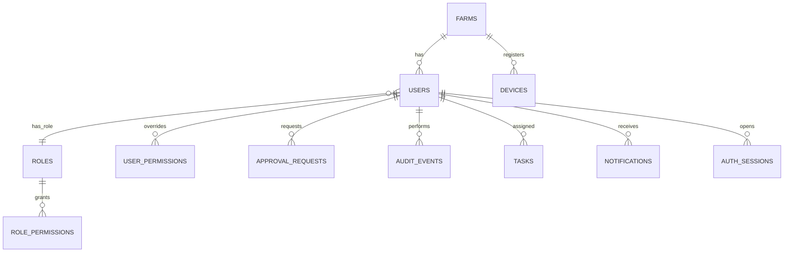

**8.2.2 Herd, breeding & health**
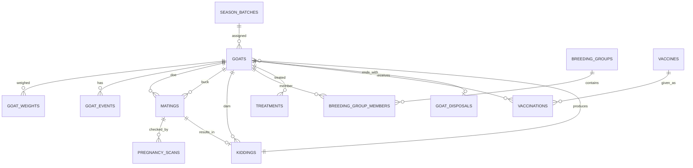

**8.2.3 Feed**
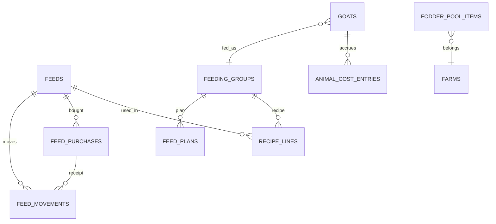

**8.2.4 Products & stock ledger**
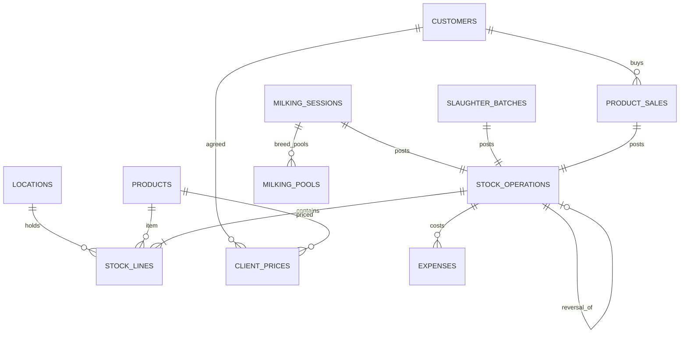

**8.2.5 Finance & projects**
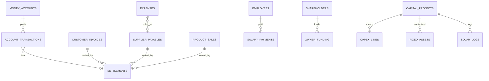

**8.2.6 Trading (separate books)**
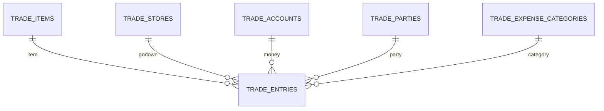

### 8.3 Proposed table list (83 tables)
| Domain | Tables |
|---|---|
| Identity/control (12) | farms, devices, users, roles, role_permissions, user_permissions, auth_sessions, approval_requests, audit_events, notifications, tasks, farm_settings |
| Lookups (1) | lookup_values (type, value) — replaces INCOME_TYPES, EXPENSE_TYPES, BREED_NAMES, OWNERS, HEALTH_STATES, VACCINE_UNITS, custom sale types, dropdown options |
| Herd/breeding (13) | goats, goat_weights, goat_events (bcs, heat, status change, wean, class, dry-off, tag), herd_groups, season_batches, matings, pregnancy_scans, kiddings, breeding_groups, breeding_group_members, goat_disposals (death/sale/slaughter), live_goat_sales, treatments |
| Health (4) | vaccines, vaccinations, health_reminders, vaccine_purchases |
| Feed (11) | feeds, feeding_groups, recipe_lines, feed_plans, feed_plan_direct, feed_purchases, feed_movements, stock_checks, fodder_pool_items, kid_diet_bands, animal_cost_entries |
| Products/stock (14) | locations, products, stock_operations, stock_lines, milking_sessions, milking_pools, slaughter_batches, product_sales, customers, client_prices, product_pricing, delivery_routes, transport_shipments, cost_allocations |
| Finance (15) | money_accounts, account_transactions, settlements, incomes, expenses, customer_invoices, supplier_payables, recurring_costs, employees, salary_payments, shareholders, owner_funding, profit_partners, loans, budgets |
| Projects (4) | capital_projects, capex_lines, fixed_assets, solar_logs |
| Trading (6) | trade_items, trade_stores, trade_accounts, trade_expense_categories, trade_parties, trade_entries |
| Sync/AI (3) | sync_outbox_receipts (idempotency keys), sync_conflicts, ai_action_log |

Total = 12+1+13+4+11+14+15+4+6+3 = **83 tables**. Of these, 14 can be deferred to a second release because they back secondary screens (those screens stay unavailable until then): devices, notifications, delivery_routes, product_pricing, transport_shipments, cost_allocations, solar_logs, budgets, profit_partners, kid_diet_bands, stock_checks, sync_conflicts, ai_action_log, feed_plan_direct — **69 tables for MVP**.

### 8.4 Foreign-key table (principal relationships)
| Child.column | → Parent | On delete | Note |
|---|---|---|---|
| *.farm_id | farms.id | RESTRICT | tenancy |
| users.role_id | roles.id | RESTRICT | |
| user_permissions.user_id | users.id | CASCADE | |
| goats.dam_id | goats.id | SET NULL | replaces damId/damTag |
| goats.sire_id | goats.id | SET NULL | **new** — today sire is free text `sireTag` |
| goats.season_batch_id | season_batches.id | SET NULL | |
| goats.feeding_group_id | feeding_groups.id | SET NULL | |
| matings.doe_id / buck_id | goats.id | RESTRICT | replaces goat.matedDate/buck |
| matings.breeding_group_id | breeding_groups.id | SET NULL | |
| pregnancy_scans.mating_id | matings.id | CASCADE | |
| kiddings.mating_id | matings.id | SET NULL | |
| kiddings.dam_id | goats.id | RESTRICT | |
| goats.birth_kidding_id | kiddings.id | SET NULL | replaces kidIds |
| treatments.goat_id | goats.id | RESTRICT | |
| treatments.expense_id | expenses.id | SET NULL | |
| vaccinations.vaccine_id / goat_id | vaccines.id / goats.id | RESTRICT | |
| feed_purchases.feed_id | feeds.id | RESTRICT | today matched by display name (DEF-07) |
| feed_purchases.payable_id | supplier_payables.id | SET NULL | |
| feed_movements.feed_id | feeds.id | RESTRICT | |
| stock_lines.operation_id | stock_operations.id | CASCADE | |
| stock_lines.product_id | products.id | RESTRICT | builtin items become products |
| stock_lines.location_id | locations.id | RESTRICT | |
| stock_operations.reversal_of | stock_operations.id | RESTRICT | |
| milking_sessions.stock_operation_id | stock_operations.id | RESTRICT | |
| slaughter_batches.goat_id | goats.id | SET NULL | outside animals allowed |
| product_sales.customer_id | customers.id | RESTRICT | |
| product_sales.stock_operation_id | stock_operations.id | RESTRICT | |
| account_transactions.account_id / to_account_id | money_accounts.id | RESTRICT | |
| account_transactions.(source_type, source_id) | polymorphic | — | enforce via trigger or per-type nullable FKs |
| settlements.account_tx_id | account_transactions.id | RESTRICT | |
| expenses.payable_id | supplier_payables.id | SET NULL | |
| expenses.stock_operation_id | stock_operations.id | SET NULL | `postCost` |
| salary_payments.employee_id | employees.id | RESTRICT | |
| owner_funding.shareholder_id | shareholders.id | RESTRICT | |
| capex_lines.project_id | capital_projects.id | RESTRICT | today deleting a project orphans capex (DEF-12) |
| fixed_assets.project_id | capital_projects.id | SET NULL | |
| trade_entries.item_id/store_id/account_id/to_account_id/party_id/category_id | trade_* | RESTRICT | |
| audit_events.user_id | users.id | SET NULL | |

### 8.5 DDL (core subset, PostgreSQL 15+)
```sql
-- [Proposed] — not present in index.html
CREATE EXTENSION IF NOT EXISTS pgcrypto;

CREATE TABLE farms (
  id UUID PRIMARY KEY DEFAULT gen_random_uuid(),
  name TEXT NOT NULL,
  location TEXT,                       -- e.g. 'Toba Tek Singh, Punjab'
  currency CHAR(3) NOT NULL DEFAULT 'PKR',
  books_from DATE,
  created_at TIMESTAMPTZ NOT NULL DEFAULT now()
);

CREATE TABLE devices (
  id UUID PRIMARY KEY,
  farm_id UUID NOT NULL REFERENCES farms(id),
  device_code CHAR(3) NOT NULL,        -- V242 code, alphabet A-Z2-9 without I,O,0,1
  label TEXT, last_seen_at TIMESTAMPTZ,
  UNIQUE (farm_id, device_code)
);

CREATE TABLE roles (
  id UUID PRIMARY KEY DEFAULT gen_random_uuid(),
  farm_id UUID NOT NULL REFERENCES farms(id),
  name TEXT NOT NULL, is_template BOOLEAN NOT NULL DEFAULT false,
  UNIQUE (farm_id, name)
);

CREATE TYPE perm_action AS ENUM ('view','create','edit','del');
CREATE TYPE perm_module AS ENUM ('dash','herd','breed','milk','feed','trade','health','finance','bank','projects','reports','tasks','admin');

CREATE TABLE role_permissions (
  role_id UUID REFERENCES roles(id) ON DELETE CASCADE,
  module perm_module NOT NULL, action perm_action NOT NULL,
  PRIMARY KEY (role_id, module, action)
);

CREATE TABLE users (
  id UUID PRIMARY KEY,
  farm_id UUID NOT NULL REFERENCES farms(id),
  username CITEXT NOT NULL,
  display_name TEXT NOT NULL,
  role_id UUID NOT NULL REFERENCES roles(id),
  password_hash TEXT NOT NULL,         -- argon2id, NOT sha256(salt:pw)
  must_change BOOLEAN NOT NULL DEFAULT true,
  status TEXT NOT NULL DEFAULT 'active' CHECK (status IN ('active','disabled')),
  is_super_admin BOOLEAN NOT NULL DEFAULT false,
  created_at TIMESTAMPTZ NOT NULL DEFAULT now(),
  UNIQUE (farm_id, username)
);

CREATE TABLE user_permissions (
  user_id UUID REFERENCES users(id) ON DELETE CASCADE,
  module perm_module NOT NULL, action perm_action NOT NULL, allowed BOOLEAN NOT NULL,
  PRIMARY KEY (user_id, module, action)
);

CREATE TABLE approval_requests (
  id UUID PRIMARY KEY,
  farm_id UUID NOT NULL REFERENCES farms(id),
  user_id UUID NOT NULL REFERENCES users(id),
  module perm_module NOT NULL, action perm_action NOT NULL CHECK (action IN ('edit','del')),
  record_id TEXT, reason TEXT NOT NULL,
  status TEXT NOT NULL DEFAULT 'pending' CHECK (status IN ('pending','approved','rejected','used','expired')),
  decided_by UUID REFERENCES users(id), decided_at TIMESTAMPTZ,
  expires_at TIMESTAMPTZ, used_at TIMESTAMPTZ,
  created_at TIMESTAMPTZ NOT NULL DEFAULT now()
);

CREATE TABLE audit_events (
  id BIGSERIAL PRIMARY KEY,
  farm_id UUID NOT NULL REFERENCES farms(id),
  ts TIMESTAMPTZ NOT NULL DEFAULT now(),
  user_id UUID REFERENCES users(id), device_code CHAR(3),
  action TEXT NOT NULL, entity TEXT, entity_id TEXT,
  detail JSONB, channel TEXT,          -- 'ui' | 'voice' | 'api'
  request_id UUID
);
CREATE INDEX ON audit_events (farm_id, ts DESC);

CREATE TABLE season_batches (
  id UUID PRIMARY KEY, farm_id UUID NOT NULL REFERENCES farms(id),
  name TEXT NOT NULL, kid_from_mmdd CHAR(5) NOT NULL, kid_to_mmdd CHAR(5) NOT NULL
);

CREATE TABLE goats (
  id UUID PRIMARY KEY,
  farm_id UUID NOT NULL REFERENCES farms(id),
  legacy_id TEXT,
  tag TEXT NOT NULL,
  name TEXT, breed TEXT, gender CHAR(1) CHECK (gender IN ('F','M')),
  status TEXT NOT NULL CHECK (status IN ('kid','milking','pregnant','dry','buck','meat','sale')),
  status_date DATE,
  birth_or_entry_date DATE NOT NULL,
  source TEXT NOT NULL CHECK (source IN ('born','bought')),
  purchase_price NUMERIC(14,2) NOT NULL DEFAULT 0,
  owner TEXT, health_state TEXT, health_since DATE,
  dam_id UUID REFERENCES goats(id) ON DELETE SET NULL,
  sire_id UUID REFERENCES goats(id) ON DELETE SET NULL,
  sire_text TEXT,                      -- migration of free-text sireTag
  season_batch_id UUID REFERENCES season_batches(id),
  herd_group TEXT, feeding_group_id UUID,
  young_class TEXT CHECK (young_class IN ('doeling','buckling','meat')),
  wean_date DATE, untagged BOOLEAN NOT NULL DEFAULT false,
  pedigree_only BOOLEAN NOT NULL DEFAULT false,
  archived_reason TEXT CHECK (archived_reason IN ('died','sold','slaughtered')),
  archived_date DATE,
  note TEXT,
  created_at TIMESTAMPTZ NOT NULL DEFAULT now(), created_by UUID, device_code CHAR(3),
  updated_at TIMESTAMPTZ, updated_by UUID, version INT NOT NULL DEFAULT 1
);
-- tag unique across ALL goats incl. archived (fixes DEF-05)
CREATE UNIQUE INDEX goats_tag_uq ON goats (farm_id, lower(tag)) WHERE NOT untagged;

CREATE TABLE goat_weights (
  id UUID PRIMARY KEY, goat_id UUID NOT NULL REFERENCES goats(id) ON DELETE CASCADE,
  date DATE NOT NULL, kg NUMERIC(7,2) NOT NULL CHECK (kg > 0)
);

CREATE TABLE goat_events (           -- heat, bcs, status, wean, class, graduate, dry_off, tag, prep
  id UUID PRIMARY KEY, goat_id UUID NOT NULL REFERENCES goats(id) ON DELETE CASCADE,
  type TEXT NOT NULL, date DATE NOT NULL, value JSONB,
  created_at TIMESTAMPTZ NOT NULL DEFAULT now(), created_by UUID
);

CREATE TABLE breeding_groups (
  id UUID PRIMARY KEY, farm_id UUID NOT NULL REFERENCES farms(id),
  name TEXT NOT NULL, buck_id UUID NOT NULL REFERENCES goats(id),
  start_date DATE NOT NULL, end_date DATE, max_does INT NOT NULL DEFAULT 15,
  status TEXT NOT NULL DEFAULT 'active' CHECK (status IN ('active','closed'))
);

CREATE TABLE matings (
  id UUID PRIMARY KEY, farm_id UUID NOT NULL REFERENCES farms(id),
  doe_id UUID NOT NULL REFERENCES goats(id),
  buck_id UUID REFERENCES goats(id), buck_text TEXT,
  breeding_group_id UUID REFERENCES breeding_groups(id),
  prep_date DATE, mated_date DATE NOT NULL,
  outcome TEXT CHECK (outcome IN ('pending','pregnant','empty','returned_heat','aborted','kidded','cleared')),
  outcome_date DATE, related_warning TEXT
);
CREATE UNIQUE INDEX one_open_mating_per_doe ON matings (doe_id) WHERE outcome IN ('pending','pregnant');

CREATE TABLE pregnancy_scans (
  id UUID PRIMARY KEY, mating_id UUID NOT NULL REFERENCES matings(id) ON DELETE CASCADE,
  date DATE NOT NULL, kids_expected INT NOT NULL CHECK (kids_expected BETWEEN 0 AND 8)
);

CREATE TABLE kiddings (
  id UUID PRIMARY KEY, farm_id UUID NOT NULL REFERENCES farms(id),
  dam_id UUID NOT NULL REFERENCES goats(id), mating_id UUID REFERENCES matings(id),
  date DATE NOT NULL, alive_female INT NOT NULL DEFAULT 0, alive_male INT NOT NULL DEFAULT 0,
  stillborn INT NOT NULL DEFAULT 0, ease TEXT, note TEXT,   -- ease/note are dropped today (DEF-04)
  CHECK (alive_female + alive_male + stillborn > 0 AND alive_female + alive_male <= 8)
);

CREATE TABLE treatments (
  id UUID PRIMARY KEY, goat_id UUID NOT NULL REFERENCES goats(id),
  date DATE NOT NULL, state TEXT NOT NULL, problem TEXT, medicine TEXT,
  cost NUMERIC(14,2) NOT NULL DEFAULT 0, withdrawal_days INT NOT NULL DEFAULT 0,
  recovered_date DATE, expense_id UUID
);

CREATE TABLE vaccines (
  id UUID PRIMARY KEY, farm_id UUID NOT NULL REFERENCES farms(id),
  name TEXT NOT NULL, scope TEXT NOT NULL,
  rule_type TEXT NOT NULL CHECK (rule_type IN ('age','repeat')),
  age_days INT, repeat_months INT, note TEXT, deleted_at TIMESTAMPTZ,
  CHECK ((rule_type='age' AND age_days IS NOT NULL) OR (rule_type='repeat' AND repeat_months IS NOT NULL))
);
CREATE TABLE vaccinations (
  id UUID PRIMARY KEY, vaccine_id UUID NOT NULL REFERENCES vaccines(id),
  goat_id UUID NOT NULL REFERENCES goats(id), date DATE NOT NULL,
  UNIQUE (vaccine_id, goat_id, date)
);

CREATE TABLE money_accounts (
  id UUID PRIMARY KEY, farm_id UUID NOT NULL REFERENCES farms(id),
  name TEXT NOT NULL, type TEXT NOT NULL CHECK (type IN ('cash','bank')),
  opening NUMERIC(14,2) NOT NULL DEFAULT 0, opening_locked BOOLEAN NOT NULL DEFAULT false,
  active BOOLEAN NOT NULL DEFAULT true, UNIQUE (farm_id, name)
);

CREATE TABLE account_transactions (       -- append-only
  id UUID PRIMARY KEY, farm_id UUID NOT NULL REFERENCES farms(id),
  date DATE NOT NULL,
  account_id UUID NOT NULL REFERENCES money_accounts(id),
  to_account_id UUID REFERENCES money_accounts(id),
  direction TEXT NOT NULL CHECK (direction IN ('in','out','transfer')),
  amount NUMERIC(14,2) NOT NULL CHECK (amount > 0),
  source_type TEXT, source_id UUID, settlement_id UUID,
  person TEXT, note TEXT,
  reversal_of UUID REFERENCES account_transactions(id),
  created_at TIMESTAMPTZ NOT NULL DEFAULT now(), created_by UUID, device_code CHAR(3),
  CHECK (direction <> 'transfer' OR (to_account_id IS NOT NULL AND to_account_id <> account_id))
);
-- idempotent linked posting (BR-FIN-03)
CREATE UNIQUE INDEX acct_tx_linked_uq ON account_transactions (farm_id, source_type, source_id, direction)
  WHERE source_type IS NOT NULL AND settlement_id IS NULL AND reversal_of IS NULL;

CREATE TABLE expenses (
  id UUID PRIMARY KEY, farm_id UUID NOT NULL REFERENCES farms(id),
  date DATE NOT NULL, type TEXT NOT NULL, amount NUMERIC(14,2) NOT NULL CHECK (amount > 0),
  account_id UUID REFERENCES money_accounts(id), payable_id UUID,
  source_type TEXT, source_id UUID, note TEXT, deleted_at TIMESTAMPTZ
);
CREATE TABLE incomes (
  id UUID PRIMARY KEY, farm_id UUID NOT NULL REFERENCES farms(id),
  date DATE NOT NULL, type TEXT NOT NULL, amount NUMERIC(14,2) NOT NULL CHECK (amount > 0),
  account_id UUID NOT NULL REFERENCES money_accounts(id), note TEXT, deleted_at TIMESTAMPTZ
);
CREATE TABLE supplier_payables (
  id UUID PRIMARY KEY, farm_id UUID NOT NULL REFERENCES farms(id),
  supplier TEXT NOT NULL, type TEXT NOT NULL, date DATE NOT NULL, due_date DATE,
  amount NUMERIC(14,2) NOT NULL CHECK (amount > 0), initial_paid NUMERIC(14,2) NOT NULL DEFAULT 0,
  source_type TEXT, source_id UUID, expense_id UUID, note TEXT,
  CHECK (initial_paid <= amount)
);
CREATE TABLE customer_invoices (
  id UUID PRIMARY KEY, farm_id UUID NOT NULL REFERENCES farms(id),
  type TEXT NOT NULL, customer TEXT NOT NULL, date DATE NOT NULL, due_date DATE,
  amount NUMERIC(14,2) NOT NULL CHECK (amount > 0), initial_received NUMERIC(14,2) NOT NULL DEFAULT 0,
  status TEXT NOT NULL DEFAULT 'open' CHECK (status IN ('open','paid','cancelled'))
);
CREATE TABLE settlements (
  id UUID PRIMARY KEY, farm_id UUID NOT NULL REFERENCES farms(id),
  direction TEXT NOT NULL CHECK (direction IN ('in','out')),
  source_type TEXT NOT NULL, source_id UUID NOT NULL,
  amount NUMERIC(14,2) NOT NULL CHECK (amount > 0), date DATE NOT NULL,
  account_tx_id UUID NOT NULL REFERENCES account_transactions(id), note TEXT
);

CREATE TABLE locations (
  id UUID PRIMARY KEY, farm_id UUID NOT NULL REFERENCES farms(id),
  name TEXT NOT NULL,
  kind TEXT NOT NULL CHECK (kind IN ('raw_tank','past_tank','frozen_milk','dairy_store','meat_store','trade_store','other')),
  capacity NUMERIC(14,3), capacity_unit TEXT, target_temp_c NUMERIC(5,1),
  city TEXT, active BOOLEAN NOT NULL DEFAULT true, UNIQUE (farm_id, lower(name))
);
CREATE TABLE products (
  id UUID PRIMARY KEY, farm_id UUID NOT NULL REFERENCES farms(id),
  item_code TEXT NOT NULL,             -- 'milk_raw','milk_past','carcass_whole','carcass_half' or 'p:<uuid>'
  category TEXT NOT NULL CHECK (category IN ('milk','carcass','dairy','meat','other','trade')),
  name TEXT NOT NULL, pack TEXT, unit TEXT NOT NULL, sku TEXT, default_price NUMERIC(14,2),
  milk_treatment TEXT, meat_type TEXT, active BOOLEAN NOT NULL DEFAULT true,
  UNIQUE (farm_id, item_code)
);
CREATE TABLE stock_operations (           -- append-only
  id UUID PRIMARY KEY, farm_id UUID NOT NULL REFERENCES farms(id),
  op_no TEXT NOT NULL,                  -- PZ-20261029-K7Q-001
  type TEXT NOT NULL CHECK (type IN ('purchase','receipt','pasteurize','make','transfer','adjust','sale','slaughter','split','cut','production','reversal')),
  date DATE NOT NULL, ref TEXT, note TEXT,
  source_key TEXT,                      -- 'session:<id>' etc.
  meta JSONB NOT NULL DEFAULT '{}',
  reversal_of UUID REFERENCES stock_operations(id),
  reversed_by UUID REFERENCES stock_operations(id), reverse_reason TEXT,
  written_off BOOLEAN NOT NULL DEFAULT false, warning TEXT, imported BOOLEAN NOT NULL DEFAULT false,
  created_at TIMESTAMPTZ NOT NULL DEFAULT now(), created_by UUID, device_code CHAR(3),
  UNIQUE (farm_id, op_no), UNIQUE (farm_id, source_key)
);
CREATE TABLE stock_lines (
  id UUID PRIMARY KEY DEFAULT gen_random_uuid(),
  operation_id UUID NOT NULL REFERENCES stock_operations(id) ON DELETE CASCADE,
  product_id UUID NOT NULL REFERENCES products(id),
  location_id UUID NOT NULL REFERENCES locations(id),
  batch TEXT NOT NULL DEFAULT '',
  qty NUMERIC(14,3) NOT NULL CHECK (qty <> 0),
  count INT NOT NULL DEFAULT 0,
  value NUMERIC(14,2) NOT NULL
);
CREATE INDEX ON stock_lines (product_id, location_id, batch);
CREATE VIEW stock_balances AS
  SELECT l.product_id, l.location_id, l.batch, SUM(l.qty) qty, SUM(l.count) count, SUM(l.value) value
  FROM stock_lines l GROUP BY 1,2,3;

CREATE TABLE milking_sessions (
  id UUID PRIMARY KEY, farm_id UUID NOT NULL REFERENCES farms(id),
  date DATE NOT NULL, session TEXT NOT NULL,
  mode TEXT NOT NULL CHECK (mode IN ('breed','goat','total')),
  goats INT, total_l NUMERIC(10,2) NOT NULL, rejected_l NUMERIC(10,2) NOT NULL DEFAULT 0,
  usable_l NUMERIC(10,2) NOT NULL CHECK (usable_l > 0),
  location_id UUID NOT NULL REFERENCES locations(id),
  stock_operation_id UUID REFERENCES stock_operations(id),
  dup_ok BOOLEAN NOT NULL DEFAULT false, note TEXT,
  created_at TIMESTAMPTZ NOT NULL DEFAULT now(), created_by UUID, device_code CHAR(3),
  CHECK (rejected_l <= total_l)
);
-- V242 rule is a *warning*, so no unique constraint on (date, session); see ADR-07

CREATE TABLE customers (id UUID PRIMARY KEY, farm_id UUID NOT NULL REFERENCES farms(id), name TEXT NOT NULL, phone TEXT, active BOOLEAN NOT NULL DEFAULT true);
CREATE TABLE product_sales (
  id UUID PRIMARY KEY, farm_id UUID NOT NULL REFERENCES farms(id),
  invoice_no TEXT NOT NULL,             -- SF-202610-K7Q-0001
  date DATE NOT NULL, sale_type TEXT NOT NULL CHECK (sale_type IN ('raw','past','dairy','whole','half','cut','other')),
  product_id UUID NOT NULL REFERENCES products(id), location_id UUID NOT NULL REFERENCES locations(id),
  batch TEXT, qty NUMERIC(14,3) NOT NULL CHECK (qty > 0), count INT NOT NULL DEFAULT 0,
  price_basis TEXT NOT NULL CHECK (price_basis IN ('unit','fixed')),
  rate NUMERIC(14,4) NOT NULL, amount NUMERIC(14,2) NOT NULL CHECK (amount > 0),
  customer_id UUID REFERENCES customers(id), customer_name TEXT,
  payment_status TEXT NOT NULL CHECK (payment_status IN ('paid','partial','credit')),
  initial_received NUMERIC(14,2) NOT NULL DEFAULT 0, account_id UUID REFERENCES money_accounts(id),
  due_date DATE, delivery_ref TEXT, income_type TEXT NOT NULL,
  unit_cost NUMERIC(14,4), cogs NUMERIC(14,2), stock_operation_id UUID REFERENCES stock_operations(id),
  cancelled BOOLEAN NOT NULL DEFAULT false, cancel_reason TEXT, cancelled_at TIMESTAMPTZ, cancelled_by UUID,
  refunded NUMERIC(14,2), cancel_restocked BOOLEAN,
  UNIQUE (farm_id, lower(invoice_no)),
  CHECK (initial_received <= amount)
);

CREATE TABLE slaughter_batches (
  id UUID PRIMARY KEY, farm_id UUID NOT NULL REFERENCES farms(id),
  ref TEXT NOT NULL, date DATE NOT NULL,
  goat_id UUID REFERENCES goats(id), animal_tag TEXT, breed TEXT,
  live_kg NUMERIC(7,2), carcass_kg NUMERIC(7,2) NOT NULL CHECK (carcass_kg > 0),
  animal_cost NUMERIC(14,2) NOT NULL DEFAULT 0, fee NUMERIC(14,2) DEFAULT 0, labour NUMERIC(14,2) DEFAULT 0, other NUMERIC(14,2) DEFAULT 0,
  location_id UUID NOT NULL REFERENCES locations(id), stock_operation_id UUID REFERENCES stock_operations(id),
  reversed BOOLEAN NOT NULL DEFAULT false, dup_ok BOOLEAN NOT NULL DEFAULT false,
  UNIQUE (farm_id, ref), CHECK (live_kg IS NULL OR carcass_kg <= live_kg)
);

CREATE TABLE feeds (id UUID PRIMARY KEY, farm_id UUID NOT NULL REFERENCES farms(id), key TEXT NOT NULL, name TEXT NOT NULL,
  use_type TEXT NOT NULL CHECK (use_type IN ('recipe','direct','fodder')), active_months INT[], price_per_kg NUMERIC(10,2),
  full_level_kg NUMERIC(12,2), UNIQUE (farm_id, key));
CREATE TABLE feed_purchases (
  id UUID PRIMARY KEY, farm_id UUID NOT NULL REFERENCES farms(id), feed_id UUID NOT NULL REFERENCES feeds(id),
  date DATE NOT NULL, kg NUMERIC(12,2) NOT NULL CHECK (kg > 0), rate NUMERIC(10,2) NOT NULL CHECK (rate > 0),
  amount NUMERIC(14,2) NOT NULL, allocation_months INT NOT NULL DEFAULT 1 CHECK (allocation_months BETWEEN 1 AND 12),
  allocation_start DATE, payment_status TEXT NOT NULL CHECK (payment_status IN ('paid','partial','credit')),
  initial_paid NUMERIC(14,2) NOT NULL DEFAULT 0, account_id UUID REFERENCES money_accounts(id),
  supplier TEXT, due_date DATE, payable_id UUID REFERENCES supplier_payables(id), note TEXT
);
CREATE TABLE feed_movements (          -- replaces feedStock{} + feedUsage[]
  id UUID PRIMARY KEY, farm_id UUID NOT NULL REFERENCES farms(id), feed_id UUID NOT NULL REFERENCES feeds(id),
  date DATE NOT NULL, kind TEXT NOT NULL CHECK (kind IN ('purchase','auto_use','manual_use','count_adjust','kid_diet')),
  kg NUMERIC(12,2) NOT NULL, source_id UUID,
  UNIQUE (farm_id, feed_id, date, kind, source_id)   -- one auto-use per feed per day
);
CREATE TABLE animal_cost_entries (
  id UUID PRIMARY KEY, goat_id UUID NOT NULL REFERENCES goats(id), date DATE NOT NULL,
  source TEXT NOT NULL CHECK (source IN ('feed-plan','kid-milk')), amount NUMERIC(12,2) NOT NULL,
  UNIQUE (goat_id, date, source)
);

CREATE TABLE trade_items   (id UUID PRIMARY KEY, farm_id UUID NOT NULL REFERENCES farms(id), name TEXT NOT NULL, unit TEXT NOT NULL DEFAULT 'kg', price_per_unit NUMERIC(14,4), note TEXT, active BOOLEAN NOT NULL DEFAULT true, UNIQUE(farm_id, lower(name)));
CREATE TABLE trade_stores  (id UUID PRIMARY KEY, farm_id UUID NOT NULL REFERENCES farms(id), name TEXT NOT NULL, place TEXT, active BOOLEAN NOT NULL DEFAULT true, UNIQUE(farm_id, lower(name)));
CREATE TABLE trade_accounts(id UUID PRIMARY KEY, farm_id UUID NOT NULL REFERENCES farms(id), name TEXT NOT NULL, type TEXT NOT NULL CHECK (type IN ('cash','bank')), opening NUMERIC(14,2) NOT NULL DEFAULT 0, note TEXT, active BOOLEAN NOT NULL DEFAULT true);
CREATE TABLE trade_expense_categories(id UUID PRIMARY KEY, farm_id UUID NOT NULL REFERENCES farms(id), name TEXT NOT NULL, active BOOLEAN NOT NULL DEFAULT true);
CREATE TABLE trade_parties (id UUID PRIMARY KEY, farm_id UUID NOT NULL REFERENCES farms(id), role TEXT NOT NULL CHECK (role IN ('supplier','customer')), name TEXT NOT NULL, phone TEXT, place TEXT, opening NUMERIC(14,2) NOT NULL DEFAULT 0, note TEXT, active BOOLEAN NOT NULL DEFAULT true, UNIQUE(farm_id, role, lower(name)));
CREATE TABLE trade_entries (           -- append-only; cancel = flag
  id UUID PRIMARY KEY, farm_id UUID NOT NULL REFERENCES farms(id),
  type TEXT NOT NULL CHECK (type IN ('buy','sell','loss','pay','receive','expense','capital','drawing','transfer')),
  date DATE NOT NULL, item_id UUID REFERENCES trade_items(id), store_id UUID REFERENCES trade_stores(id),
  party_id UUID REFERENCES trade_parties(id), party_text TEXT,
  qty NUMERIC(14,3), rate NUMERIC(14,6), rate_basis TEXT, rate_entered NUMERIC(14,4),
  freight NUMERIC(14,2) DEFAULT 0, labour NUMERIC(14,2) DEFAULT 0,
  payment TEXT, paid NUMERIC(14,2), received NUMERIC(14,2), amount NUMERIC(14,2),
  account_id UUID REFERENCES trade_accounts(id), to_account_id UUID REFERENCES trade_accounts(id),
  category_id UUID REFERENCES trade_expense_categories(id),
  loss_reason TEXT CHECK (loss_reason IN ('dry','spoil','farm','count-','count+')),
  bill_no TEXT, due_date DATE, note TEXT,
  cancelled BOOLEAN NOT NULL DEFAULT false, cancel_reason TEXT, cancelled_at TIMESTAMPTZ, cancelled_by UUID,
  created_at TIMESTAMPTZ NOT NULL DEFAULT now(), created_by UUID, device_code CHAR(3)
);
CREATE UNIQUE INDEX trade_bill_uq ON trade_entries (farm_id, lower(bill_no)) WHERE bill_no IS NOT NULL;
```
Remaining tables (employees, salary_payments, shareholders, owner_funding, profit_partners, loans, budgets, recurring_costs, capital_projects, capex_lines, fixed_assets, solar_logs, tasks, notifications, reminders, vaccine_purchases, fodder_pool_items, feeding_groups, recipe_lines, feed_plans, transport_shipments, cost_allocations, client_prices, product_pricing, delivery_routes, milking_pools, breeding_group_members, goat_disposals, live_goat_sales, herd_groups, lookup_values, sync tables) follow the same conventions with the field lists in §7.

### 8.6 Migration mapping from `goatHerd_v4`
| JSON source | Target | Transform |
|---|---|---|
| `goats[].matedDate/buck/prepCross/kids/usDate/emptyLog/abortions` | `matings`, `pregnancy_scans`, `goat_events` | one open mating per doe; history rows from emptyLog/abortions/kiddings |
| `goats[].sireTag`, `buck` (text) | `goats.sire_id` via case-insensitive tag match over all goats (`anyByTag` L8697); keep `sire_text` when no match | |
| `goats[].weights[]`, `bcs[]`, `heats[]` | `goat_weights`, `goat_events` | |
| `feedStock{}` + `feedUsage[]` + `feedBuys[]` | `feed_movements` (opening balance row per feed = current feedStock − Σ later movements) | |
| `feedBuys[].feed` (display name) | `feed_purchases.feed_id` via FEEDS name match (`feedPurchaseKey` L6939) | |
| `stockOps[]` | `stock_operations` + `stock_lines` 1:1 | builtin items → seeded products |
| `tradeRecs[]` | 6 trade tables by `kind` | |
| `users[].hash/salt` | cannot be converted → force password reset (`must_change=true`) | |
| `eventLog[]` | `audit_events` | |
| `kidMilkDiet` + `localStorage['sandeel_v183_kid_milk_diet']` | `kid_diet_bands` | take the newer of the two |

---

## 9. Data Lineage

### 9.1 Milk: from goat to cash
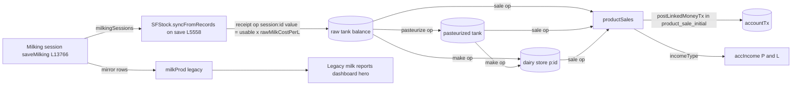

### 9.2 Meat: from goat to cuts
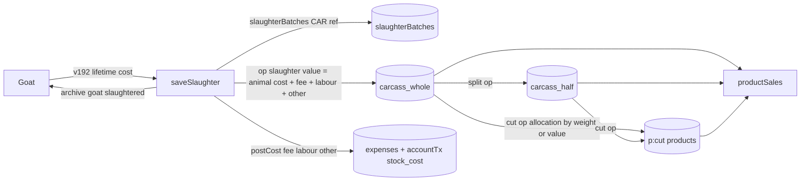

### 9.3 Money postings (who writes `accountTx`)
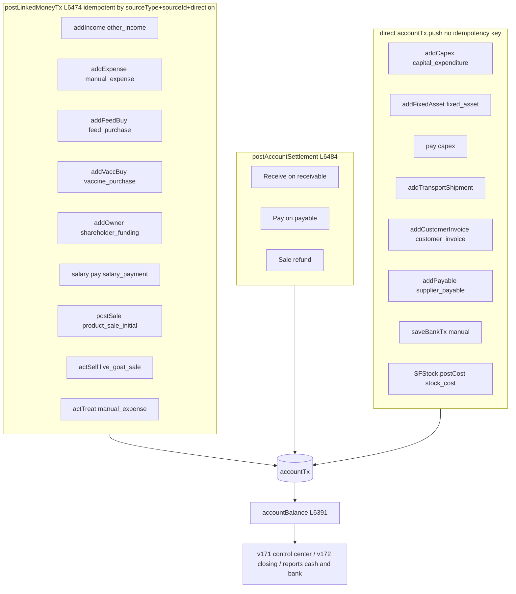

### 9.4 Feed cost flow
`feedBuys` → `feedStock[k] += kg`, `prices[k] = Σamount/Σkg` (L6939) → daily `autoDeductUsage` (L6989) reduces `feedStock` by plan usage and calls `v192TrackFeedDay` → `animalCostLedger` (per-goat daily cost) → `v192AnimalLifetimeCost` → slaughter animal cost default & live goat sale `cost`.
P&L uses **allocated** feed cost (`feedAllocatedInRange`: purchase amount spread over `allocationMonths`), not consumption.

### 9.5 Where each headline number comes from
| Number (screen) | Formula / source | Line |
|---|---|---|
| P&L income (Finance › P&L, Reports, v171 control center, profit share) | `accIncome(R)` = legacy milkSales + live productSales by incomeType + customerInvoices + incomes | L6219 |
| P&L costs | `accCosts(R)` = feed allocated + vaccine purchases (cash date) + expenses by type + salaries accrued + recurring × monthsIn(R) + green fodder allocated | L6226 |
| Finance overview 6-month trend | legacy: milkSales + incomes vs feed cash + vaccines + expenses + salaries (today's rate) + recurring | L6127 |
| Dashboard "This month" | same legacy engine as above | L8471 |
| Reports trend buckets | milkSales + productSales (incl. cancelled) + invoices + incomes vs cash-basis costs | L7274 |
| Reports comparison | legacy milkSales + incomes (no productSales/invoices) | L8012 |
| `window.farm.finance()` (v0.35) | legacy engine; v163 version uses accIncome/accCosts | L10709, L11136+ |
| Cash & bank (Reports, control center, dashboard v168) | Σ `accountBalance` of accounts | L6391, L7156 |
| Balance-sheet cash | `openingCash + cashFlow(all).net` (derived, not account balances) | L6332 |
| Receivables (Finance) | `currentReceivablesTotal` (live productSales + goat sales + invoices) | L6328 |
| Receivables (working capital, monthly closing) | include cancelled productSales | L7156, L12522 |
| Milk litres (dashboard, reports) | legacy `milkProd` (sessions mirrored into it) | L6873 |
| Stock value (Products) | Σ ledger `value` | L14379 |
| Inventory report | feed stock × price + livestock + assets (**excludes** milk/dairy/meat ledger value) | L7919 |

---

## 10. Business Rules Catalogue

Rule IDs are stable; use them in tickets and tests. **Status** column: I = Implemented, P = Partial/defective, D = Demo only.

### 10.1 Herd (BR-HERD)
| ID | Rule | Formula / condition | Line | St |
|---|---|---|---|---|
| BR-HERD-01 | Tag and date required to add a goat | — | L9836 | I |
| BR-HERD-02 | Tag unique among **live** goats on manual add (not archived) | `findGoatByTag` uses `live()` | L9945 | P (DEF-05) |
| BR-HERD-03 | Tag unique among **all** goats on CSV import, AI addGoat, kid tagging | `anyByTag` | L10582, L8697, L9257 | I |
| BR-HERD-04 | Born goats have price 0; source = price>0 ? bought : born (CSV) | | L9836, L10582 | I |
| BR-HERD-05 | Live goat = `!archived && !pedigreeOnly` | | L5672+ | I |
| BR-HERD-06 | Parent rules: no self-parent; descendant (12 generations) cannot be parent; dam must be female | `ancestors(g,12)` | L8987 | I |
| BR-HERD-07 | Wean due when kid not weaned and (age ≥ `season.weanDays` (90) **or** latest weight ≥ `season.weanKg` (13 kg)) | | L8842 | I |
| BR-HERD-08 | Young classification due at age ≥ 210 days (`YOUNG_CLASS_DAYS`) | | L8842 | I |
| BR-HERD-09 | Age-up alert for kids ≥ 365 days (`AGEUP_DAYS`) | | L8860 | I |
| BR-HERD-10 | Graduate: doeling → `dry`, buckling → `buck`; **meat class also → buck** | | L8878+ | P (DEF-02) |
| BR-HERD-11 | Bulk wean of kids younger than weanDays requires confirm | | L9861 | I |
| BR-HERD-12 | Death: record {date, reason, ageDays, price}; goat archived `died` | | L8878+ | I |
| BR-HERD-13 | Sell goat: price>0, buyer, date; paid now → account required; creates `sales[]` row **and** an `incomes` 'Live goat sale'; goat archived `sold`; `cost` = v192 lifetime cost or price | | L9003 | I |
| BR-HERD-14 | Temporary kid tag = `damTag + '-K' + n`; kids created `untagged:true` | | L9208 | I |
| BR-HERD-15 | Cull candidates: female non-kid with ≥2 empty scans, or ≥1 abortion, or ≥2 kiddings with <1.2 kids/birth, or age ≥6 y, or BCS ≤2, or ≥3 treatments | | L8860 | I |
| BR-HERD-16 | Archived goats are read-only in the goat card | | L9101 | I |
| BR-HERD-17 | Low weight gain alert: ADG < 70% of herd average ADG; ADG = (last kg − first kg)/days | | L7399, L7766 | I |

### 10.2 Breeding (BR-BRD)
| ID | Rule | Formula / condition | Line | St |
|---|---|---|---|---|
| BR-BRD-01 | Gestation `GEST = 150` days; due date = matedDate + 150 | | L8640 | I |
| BR-BRD-02 | Heat cycle `CYCLE = 21` days; next heat = last heat + 21 | | L8789, L8842 | I |
| BR-BRD-03 | Breeding eligibility: female, not kid/meat/buck, not archived/pedigree, age ≥ `BREED_MIN_DAYS` 300 | `breedEligible` | L8640 | I |
| BR-BRD-04 | Ineligible goats are removed from prep automatically | `cleanWrongPrep` | L8640 | I |
| BR-BRD-05 | Relationship check before crossing: parent/child, full/half sibling, aunt/uncle, grandparent ⇒ **high**; shared ancestor within 3 generations ⇒ medium (cousins) else low; user must confirm | `relation(a,b)`, `checkCross` | L8697–8746 | I |
| BR-BRD-06 | Season plan per batch: kidFrom/kidTo this year (next year if cross window passed); crossFrom = kidFrom − 150; buildFrom = crossFrom − buildUp(60); scanFrom = crossFrom + scanAfter(45); dryFrom = kidFrom − dryOff(60); weanFrom = kidFrom + weanDays(90) | `seasonPlan` | L8792 | I |
| BR-BRD-07 | Build-up feeding starts nextCross − buildUp; stop milking at nextCross − dryBeforeCross (14) | | L8808 | I |
| BR-BRD-08 | Suggested next cross after kidding = earliest batch crossFrom > kidDate + 60; else kidDate + 365 − 150 | `suggestNextCross` | L8808 | I |
| BR-BRD-09 | Plan status early/late vs window; >45 days off ⇒ red | `planStatus` | L8818 | I |
| BR-BRD-10 | Scan due when mated ≥ `scanAfter` (45) days and no scan | | L8649, L7399 | I |
| BR-BRD-11 | Scan result empty ⇒ `emptyLog` entry, clear mating, status `dry`; else `kids` = count, `usDate`, status `pregnant` | `doScan` | L9284 | I |
| BR-BRD-12 | Heat seen ≥ 17 days after mating ⇒ confirm "returned to heat" ⇒ emptyLog, clear mating, status dry | `actHeat` | L9026, L9491 | I |
| BR-BRD-13 | Kidding: alive + stillborn > 0, alive ≤ 8; creates kids (breed/owner of dam, sire from cross), dam → `milking` if alive>0 else `dry`; ease & note **not stored** | `doKidding` | L9214 | P (DEF-04) |
| BR-BRD-14 | Abortion ⇒ `abortions[]` {date,mated,buck,kids,reason}; dam dry | | L9585+ | I |
| BR-BRD-15 | "Entered by mistake" clears breeding record without trace | | L9615 | P (DEF-01: throws ReferenceError, never runs) |
| BR-BRD-16 | Prep ≥ 60 days ⇒ warning | | L9315, L7399 | I |
| BR-BRD-17 | Buck workload: ≥25 carrying = heavy, ≥15 = busy; conception = took/(took+empty) | | L9562 | I |
| BR-BRD-18 | Breeding group: default max 15 does per buck; second active group for same buck needs confirm; relation warnings; members get matedDate/buck/breedGroupId; group with results cannot be deleted | | L12992+ | I |
| BR-BRD-19 | Group success rate = (pregnant + kidded)/(pregnant + kidded + empty) | | L12992+ | I |
| BR-BRD-20 | Pregnancy rate (reports) = confirmed/(confirmed + Σ emptyLog) for current herd; ≥70% good | | L7483 | I |
| BR-BRD-21 | Dam performance: kids per birth ≥1.8 good, <1.2 bad | | L7673 | I |

### 10.3 Health (BR-HLT)
| ID | Rule | Formula | Line | St |
|---|---|---|---|---|
| BR-HLT-01 | Age-type vaccine: given once; due = birth + ageDays | `nextDue` | L8752 | I |
| BR-HLT-02 | Repeat vaccine: never given ⇒ due today; else last + months × 30 days | | L8752 | I |
| BR-HLT-03 | Due when daysUntil ≤ 0; upcoming when 0 < days ≤ window (14/30/60/90) | | L6761 | I |
| BR-HLT-04 | Treatment withdrawal: milk must not be sold for `withdrawDays` after treatment (alert "do not sell milk") | | L5880, L7399 | I (alert only; not enforced in sales) |
| BR-HLT-05 | Treatment with cost>0 needs account and sufficient balance; posts expense 'Vet / extra medicine' | `actTreat` | L8878+ | I |
| BR-HLT-06 | Vaccine purchase paid>0 needs account + balance; unpaid part creates payable 'Vaccine / medicine' | | L10208 | I |
| BR-HLT-07 | Seed schedule: ET at 30 d (kid), PPR 12 m, FMD 6 m, CCPP 12 m, ET booster 6 m (pregnant), deworming 3 m | | L5575 | D |

### 10.4 Feed (BR-FEED)
| ID | Rule | Formula | Line | St |
|---|---|---|---|---|
| BR-FEED-01 | Mix cost per kg = batch cost / total kg of recipe | `mixCostPerKg` | L5717 | I |
| BR-FEED-02 | Daily feed cost per goat = mix kg × mixCostPerKg + dry fodder kg × price + direct feeds + fodder cost per goat | `planDailyFeed` | L5778 | I |
| BR-FEED-03 | Fodder cost per goat: equal ⇒ pool/heads; share ⇒ pool × fodder_g / Σ(fodder × count) | `fodderCostPerGoat` | L5759 | I |
| BR-FEED-04 | Fodder pool items auto-excluded when matched (fuzzy, words >3 chars) to recurring costs or this year's expenses (avoid double counting) | `fodderMatch` | L5732 | I |
| BR-FEED-05 | Monthly farm feed = Σ group daily × 30 × head count | `farmFeedMonthly` | L5778 | I |
| BR-FEED-06 | Feed price after purchase = Σ amount / Σ kg over **all** purchases of that feed (overwrites manual price) | `refreshFeedPurchaseRate` | L6939 | I |
| BR-FEED-07 | Purchase amount = round(kg × rate); paid>0 ⇒ account + balance check; unpaid part ⇒ payable (amount = full purchase amount, paid = paid part) | `addFeedBuy` | L10002 | I |
| BR-FEED-08 | Purchase cost allocated evenly over 1–12 months from allocationStart (P&L) | `feedPurchaseAllocatedInMonth` | L5806 | I |
| BR-FEED-09 | Auto daily deduction: for each missed day (≤120 days back) subtract plan usage per feed, floor 0; green fodder excluded | `autoDeductUsage` | L6989 | I |
| BR-FEED-10 | Low stock ≤ 20% of `feedFull`; order now if days left < 7, watch < 14; reorder warning when days until 20% ≤ 21 | | L5778, L7008 | I |
| BR-FEED-11 | Stock check: set book = counted; log shortfall as usage (surplus not logged) | `saveCheck` | L10676 | P |
| BR-FEED-12 | Feed active only in selected months (v211; [] = all year) | `feedActiveOn` | L5717, L13148 | I |
| BR-FEED-13 | Kid milk diet bands: 0–30 d powder 250 g + mix 25 g; 31–60 d powder 350 g + mix 75 g + green 100 g; 61–90 d powder 450 g + mix 150 g + green 250 g + dry 50 g; kid eligible from birth until weaned; one auto issue per day; catch-up ≤370 days | | L12683+ | I |
| BR-FEED-14 | Feed group members: kid group = weaned & not meat class; meat group = status meat or kid with youngClass meat; unweaned kids are on milk diet | `feedGroupMembers` | L5700 | I |
| BR-FEED-15 | Lifetime animal cost = acquisition price + feed/milk (tracked ledger if any else estimated history ≤550 days) + treatment costs | `v192AnimalLifetimeCost` | L12774 | I |

### 10.5 Stock ledger — milk, dairy, meat (BR-STK)
| ID | Rule | Formula | Line | St |
|---|---|---|---|---|
| BR-STK-01 | Balance key = item × location × batch; qty, count, value are sums of signed lines | `balances()` | L13284+ | I |
| BR-STK-02 | Unit cost = value/qty (weighted average); out line takes avg cost; emptying a balance takes the whole remaining value | `outLine` | L13284+ | I |
| BR-STK-03 | Location accepts only compatible items (raw tank: raw milk; past tank: pasteurized; dairy store: dairy/other; meat store: carcass/meat; other: all but milk) unless `skipCompat` | `ACCEPT` | L13284+ | I |
| BR-STK-04 | No posting may drive any balance negative unless `allowNegative` (imports, sale-cancel restock) | `shortage()` | L13284+ | I |
| BR-STK-05 | `sourceKey` unique ⇒ each source record posts exactly once (idempotent sync) | `post()` | L13284+ | I |
| BR-STK-06 | Operation number = `PREFIX-YYYYMMDD-DEV-NNN` (PU, MR, PZ, DP, TR, ADJ, SO, SL, SP, CT, PR, REV); DEV = 3-char device code | `nextNo` | L13284+ | I |
| BR-STK-07 | Reversal: equal & opposite op; cannot reverse a reversal or reverse twice; sales only via cancel; blocked if later ops consumed the stock | `reverse`, `reverseCheck` | L13284+ | I |
| BR-STK-08 | Raw milk receipt value = usable L × `rawMilkCostPerL` (default 0 ⇒ margin shown as estimate) | `syncFromRecords` | L13284+, L14358 | I |
| BR-STK-09 | Milking: rejected ≤ total per line; usable > 0; raw tank required; unique breeds in breed mode | `saveMilking` | L13766 | I |
| BR-STK-10 | Pasteurise: out ≤ in; QC checkbox mandatory; capacity overflow ⇒ confirm; run number unique; past value = raw value + processing cost | `savePasteurize` | L13586+ | I |
| BR-STK-11 | Move milk only raw→raw or past→past | `saveMoveMilk` | | I |
| BR-STK-12 | Make dairy: out × pack size ≤ in × 1.02 else confirm; product value = milk value + packaging + ingredients + processing | `saveMake` | | I |
| BR-STK-13 | Slaughter: carcass kg > 0 and ≤ live kg; archived goat blocked; unknown tag ⇒ confirm "outside animal"; carcass value = animal cost + fee + labour + other; fees posted as expenses; **animal cost is not an expense** | `saveSlaughter` | | I |
| BR-STK-14 | Split: whole carcass only; count × 2 halves in same batch | `saveSplit` | | I |
| BR-STK-15 | Cut: kg ≤ available; Σ cuts ≤ input + 0.01; value allocated by weight or by value (falls back to weight if any price 0); last row gets rounding remainder; waste in meta | `cutAllocation`, `saveCut` | | I |
| BR-STK-16 | Transfer carcass only whole | `saveTransfer` | L14408 | I |
| BR-STK-17 | Adjustment reason "Other" requires note; in at current unit cost | `saveAdjust` | L14421 | I |
| BR-STK-18 | Keep ≥1 active raw milk tank; disabling a location holding stock needs confirm | bind | L14546 | I |
| BR-STK-19 | Raw milk costing rate changeable only by milk:edit, finance:edit or Super admin | | L14562 | I |
| BR-STK-20 | **V242 duplicate warning**: ≥2 milking sessions with same date + session name (case-insensitive) not all `dupOk`; or same goat (id or tag) in ≥2 non-reversed slaughter batches ⇒ banner; resolve by delete/reverse or "Both are real — keep" | `dupGroups` | L14623 | I |
| BR-STK-21 | Reconciliation: negative balances, sales without op, ops without sale, import warnings | `renderRecon` | L14452 | I |

### 10.6 Product sales (BR-SALE)
| ID | Rule | Formula | Line | St |
|---|---|---|---|---|
| BR-SALE-01 | Invoice no. = `SF-YYYYMM-DEV-NNNN`, unique case-insensitive | `nextInvoice` | L14273 | I |
| BR-SALE-02 | qty > 0 and ≤ available at chosen source | | L14278 | I |
| BR-SALE-03 | Whole carcass sold only at full weight | | L14281 | I |
| BR-SALE-04 | Half carcass count 1..available count | | L14282 | I |
| BR-SALE-05 | Amount = qty × rate (unit basis) or agreed total (fixed basis, rate = total/qty) | | L14285 | I |
| BR-SALE-06 | Partial payment: 0 < received < amount; received > 0 needs account | | L14288 | I |
| BR-SALE-07 | COGS = −(out line value); gross margin = amount − COGS | | L14294 | I |
| BR-SALE-08 | Review step before posting; sale rebuilt at post time (stock may have changed) | `showReview`, `postSale` | L14297, L14311 | I |
| BR-SALE-09 | Income category by sale type: raw → 'Milk sales — raw (bulk)', past → 'Milk sales — pasteurized (bulk)', dairy → 'Dairy product sales', whole/half → 'Meat sales — carcass', cut → 'Meat sales — cuts', other → 'Other product sales' | `SALE_TYPES` | L14221 | I |
| BR-SALE-10 | Cancel: needs milk:del or finance:del; reason required; restock (reverse op) or write off; received money refunded from a chosen account; sale kept as CANCELLED | `cancelSale` | L14327 | I |
| BR-SALE-11 | Client rate pre-fills from client price, else default sell price | `clientRate` | L6909 | I |

### 10.7 Finance & bank (BR-FIN)
| ID | Rule | Formula | Line | St |
|---|---|---|---|---|
| BR-FIN-01 | Account balance = opening + Σ in − Σ out − Σ transfer-out + Σ transfer-in | `accountBalance` | L6391 | I |
| BR-FIN-02 | **No overdraft**: payment > balance ⇒ blocked ("Insufficient balance") — applied by income/expense/feed/vaccine/salary/treatment/capex-pay | `canPayFromAccount` | L6467 | P (not applied everywhere, DEF-14/15) |
| BR-FIN-03 | Linked postings are idempotent per (sourceType, sourceId, direction) | `postLinkedMoneyTx` | L6474 | I |
| BR-FIN-04 | Manual bank entry blocked if identical to an auto-linked tx (same account, direction, date, amount) | `saveBankTx` | L10503 | I |
| BR-FIN-05 | Transfer requires a different destination account | | L10503 | I |
| BR-FIN-06 | Opening balance editable only while account has no movements; v168 lock: set once | | L6399, L12380 | I |
| BR-FIN-07 | Account removable only with no movements; else deactivate | | L6399 | I |
| BR-FIN-08 | Income and expense require an account; expense also balance check | | L10159, L10167 | I |
| BR-FIN-09 | v194 double-entry guard: block salary-type expenses/payables (use Payroll); warn feed/vaccine-type expenses (use purchases); warn identical same date+amount+type; warn invoice matching an existing product sale; warn live-goat-sale income | capture handler | L12795 | I |
| BR-FIN-10 | v196 safe delete: delete requires `can(module,'del',recordId)` (or one-time approval), blocks: product sale with later receipts; feed/vaccine purchase whose payable has later payments; auto-linked bank tx; consumes approval; logs `delete` | capture handler | L12847 | I |
| BR-FIN-11 | Salary due for month: inactive ⇒ 0; join month after month ⇒ 0; else full salary (no proration) | `salaryDueForMonth` | L5791 | I |
| BR-FIN-12 | Salary accrued in range walks months; salary cash by payment date | | L5791 | I |
| BR-FIN-13 | Recurring cost monthly = yearly/12; P&L recurring = Σ monthly × `monthsIn(R)` where monthsIn = days/30.44 rounded to 0.1 | `accCosts` | L6226, L6196 | P (approximation) |
| BR-FIN-14 | P&L = accIncome − accCosts; owner funding excluded | `renderPL` | L6237 | I |
| BR-FIN-15 | Cash flow net = customer cash in + owner funding + loans − running costs − goats bought − assets − capex | `cashFlow` | L6286 | P (DEF-09, DEF-17) |
| BR-FIN-16 | Balance sheet: cash (derived), receivables, livestock at purchase price, assets, feed at price, CIP; liabilities: loans + payables + capital payables | `renderBalance` | L6332 | P (DEF-16) |
| BR-FIN-17 | Profit share: distributable = max(0, net profit); allocation = distributable × share%/100; active partners must total 100% on save | | L6362, L10873, L7447 | I |
| BR-FIN-18 | Receivable receipt: account required; amount via prompt; posts settlement | | L6515 | I (no `can()`) |
| BR-FIN-19 | Payable payment: account required; posts settlement; **no balance check** | | L6532 | P (DEF-15) |
| BR-FIN-20 | Several screens compute "money in/out" with a legacy cash engine (see §9.5) | | L6127, L8471, L8012 | P (DEF-10) |
| BR-FIN-21 | Integrity check `farm.integrity()`: movement without account, movement for deleted record, duplicate movement, payable for deleted purchase, overpaid payable, bill expense missing, unknown account, negative feed stock | | L12847+ | I |
| BR-FIN-22 | Monthly closing: account balance at month end, cash vs bank, AR/AP at month end | `accountBalanceAt` | L12522 | P (AR includes cancelled sales, DEF-11) |
| BR-FIN-23 | Capex: Part Paid requires 0 < paid < amount; account if paid; due date if not fully paid; capitalise ⇒ asset cost = CIP and project Completed | | L10060, L10063 | I |
| BR-FIN-24 | CIP = max(0, project spent − capitalised) | | L7098 | I |
| BR-FIN-25 | Solar payback = investment / (savings − maintenance) "periods" | | L7098 | I |

### 10.8 Trading (BR-TRD) — separate books
| ID | Rule | Formula | Line | St |
|---|---|---|---|---|
| BR-TRD-01 | Trading never posts to farm incomes, expenses, accountTx or stock ledger | header | L14666 | I |
| BR-TRD-02 | Units: kg recommended; 1 maund = 40 kg; 1 ton = 1000 kg; rate stored per kg, entered per maund/ton/kg | `KG_PER` | L14797 | I |
| BR-TRD-03 | Books recomputed from all live entries in date order each render | `compute()` | L14725 | I |
| BR-TRD-04 | Buy: stock value += goods + freight + labour (landed cost); supplier owed += goods only; money out = paid + freight + labour | | L14738 | I |
| BR-TRD-05 | Weighted average cost per item **across godowns**; sell COGS = avg × qty (or all value if selling all) | | L14744 | I |
| BR-TRD-06 | Sell profit = amount − COGS − delivery freight | | L14750 | I |
| BR-TRD-07 | Loss reasons: dried out, spoiled, given to goat farm, count −, count + (adds at avg cost) | `LOSS` | L14909 | I |
| BR-TRD-08 | Sale/loss refused if stock would go negative **at any date** (simulation over entire history) | `checkStock` | L15062 | I |
| BR-TRD-09 | Overdraft on trading account: soft warning (confirm), not blocked (differs from farm BR-FIN-02) | | L15071, L15106 | I |
| BR-TRD-10 | Bill no. `TR-YYYYMM-DEV-NNN`, unique | `nextBill` | L14843 | I |
| BR-TRD-11 | Paying more than owed ⇒ confirm advance; paying a supplier with no purchases ⇒ confirm advance | | L15104 | I |
| BR-TRD-12 | Cancel entry: reason required; blocked if later sales/losses would go negative | `cancelEntry` | L15109 | I |
| BR-TRD-13 | P&L: gross = sales − COGS; net = gross − delivery − loss − expenses | `pl` | L14766 | I |
| BR-TRD-14 | Balance sheet check: opening + capital − drawings + profit ≈ worth (±1) ⇒ "✓ balanced" | | L14884 | I |
| BR-TRD-15 | Keep ≥1 active item, godown, account; name unique per kind (parties per role); changing an item unit with stock does not convert quantities (warning) | | L15037, L15118 | I |
| BR-TRD-16 | Migration V236: items in maund converted to kg (qty × 40, rate ÷ 40); V239: parties created from entry names | `ensure()` | L14701 | I |

### 10.9 Known inconsistencies between engines (must be resolved, not copied)
| # | Inconsistency | Lines |
|---|---|---|
| 1 | Four different "income" definitions: accIncome; legacy milkSales+incomes (overview trend, dashboard month, comparison); trend buckets incl. cancelled productSales; `farm.finance` v0.35 | L6219, L6127, L8471, L8012, L7274, L10709 |
| 2 | Cost basis: P&L uses allocated feed; overview/dashboard use feed cash; salaries at today's rate vs accrued | L6226 vs L6127 |
| 3 | Cash: balance sheet derived from cash flow; reports/control center from account balances | L6332 vs L7156 |
| 4 | Cancelled product sales included in working capital, trend, day map, monthly closing AR, AI `receivePayment` FIFO | L7156, L7274, L7353, L12522, L11136+ |
| 5 | Inventory/balance sheet exclude stock-ledger value (milk, dairy, meat) | L6332, L7919 |
| 6 | Bank report outflow excludes capex | L7325 |

### 10.10 Authentication & system rules (BR-SYS)
| ID | Rule | Line | St |
|---|---|---|---|
| BR-SYS-01 | First run creates `owner/owner` Super admin with mustChange | L8045 | D |
| BR-SYS-02 | Password change: new ≥ 4 chars and old must match; user creation has **no** strength rule | L9813, L9798 | P |
| BR-SYS-03 | Cannot disable self or the last active Super admin | L8216 | I |
| BR-SYS-04 | One-time approval: Super admin approves, valid 30 min, single use, optionally bound to record id | L8428, L5392, L5430 | I |
| BR-SYS-05 | Offline (non-demo): sensitive ops (admin/finance/payroll/bank/approvals create/edit/del, or any delete) blocked when cloud not connected | L5397 | D (disabled by SANDEEL_DEMO) |
| BR-SYS-06 | Offline login (non-demo) requires prior online auth, 24 h grace, clock-tamper detection | L8060 | D (disabled) |
| BR-SYS-07 | eventLog capped at 5000, notifs at 500 | L5442 | I |
| BR-SYS-08 | Auto backup every 7 days, keep 8 snapshots; reminder after 7 days without download | L11014 | I |
| BR-SYS-09 | AI write: one action at a time, confirmation required (except noConfirm), duplicate guard 15 s, undo last (same user, no later events, max 5) | L11136+ | I |
| BR-SYS-10 | Device code: 3 chars from A–Z2–9 excluding I, O, 0, 1; stored in localStorage `sandeel_device_code` | L13284+ | I |

---

## 11. Backend API

### 11.1 Endpoints referenced by the source (**discovered** — servers not supplied)
| # | Method & path | Caller | Request body | Auth sent | Response used | Status |
|---|---|---|---|---|---|---|
| E1 | `POST /api/approvals/request` | `requestApproval` L8424 | `{module, action, reason}` | `Authorization: Bearer ${SandeelCloud.token}` | ignored (`.catch(()=>{})`) | [Unknown] — only when `SandeelCloud.token` exists (never in preview) |
| E2 | `POST /api/approvals/{id}/decide` | `decideApproval` L8435 | `{approve: boolean}` | Bearer token | ignored | [Unknown] |
| E3 | `POST /api/ai` (`SANDEEL_AI_ENDPOINT`) | `callAI` L12204–12244 | `{max_tokens:1000, system, messages, tools}` (Anthropic Messages shape) | **none** (`credentials:'omit'`, no Authorization header) | `content[]` with `text` / `tool_use`; 503 or `AI_NOT_CONFIGURED` ⇒ basic local parser | [Unknown] |
| E4 | `GET /health` (derived: endpoint with `/api/ai` → `/health`) | `checkAiHealth` L11957 | — | none | `d.ai.configured` | [Unknown] |
| E5 | `POST /api/speech` (or `SANDEEL_TTS_ENDPOINT`) | `SandeelTTS` L11779–11790 | `{text, voice:'alloy'}` | none | audio blob | [Unknown] (stub; browser TTS used otherwise) |
| E6 | `POST ${SANDEEL_BACKUP_ENDPOINT}` | v161 `makeBackup` L11052 | `{farm, createdAt, createdBy, appVersion:'v161', data}` | cookies (`credentials:'include'`) | ok/!ok | [Unknown] — endpoint empty in preview |

Also referenced but not defined (client library absent): `SandeelCloud.login`, `.logout`, `.token`, `.status`, `.pullDelta`, `.flushQueue`, `.syncApprovals`, `.checkHealth`, `.persistChanges`, `.connected` (L5565, L8060, L8180, L13148). **Their HTTP contracts are unknown** and must not be assumed.

### 11.1b Endpoints reported by project notes (not in this HTML)
| Path | Note | Status |
|---|---|---|
| `/api/auth/*`, `/api/sync/*`, `/api/farm/*`, `/api/reports/*` (incl. `/api/reports/stock/balances`, checks milk view) | production ASP.NET Core backend | [Reported] |
| `/api/ai` | requires sign-in in the cloud build | [Reported] |
| `/health` | polled every 15 s while offline (cloud build) | [Reported] |
These must be read from the repository before any new endpoint is added.

### 11.2 In-browser API (exists): `window.farm`
| Group | Members | Line |
|---|---|---|
| Read (v0.35) | `herd()`, `goat(tag)`, `stock()`, `feedPlan()`, `finance(from,to)` (legacy engine), `milk(from,to)`, `breeding()`, `alerts()`, `events(n)`, `snapshot()` | L10709 |
| Read (v163) | `whoami`, `finance` (accIncome/accCosts), `milk`, `products`, `sales`, `tasks`, `treatments`, `vaccines`, `tables()`, `query(table,{from,to,tag,text,limit≤200})` (hides salt/hash/perms/sessionToken), `summary(date)`, `breedingGroups()` (v206), `integrity()` (v196) | L11136+, L12992, L12847 |
| Write | `tools()` (JSON-schema list filtered by permissions), `preview(name,args)`, `run(name,args)`, `undoLast()`, `needsConfirm`, `setChannel`, `version` '3.0 (v163)' | L11136+ |
| Actions (32) | recordMilk, sellMilk, sellProduct, buyFeed, addExpense, addIncome, recordWeight, changeStatus, recordTreatment, markRecovered, vaccinateGoat, vaccinateGroup, recordHeat, recordCross, recordScan, recordKidding, recordDeath, sellGoat, addTask, addGoat, recordProduction, buyVaccine, ownerFunding, paySalary, addInvoice, addSupplierBill, receivePayment, paySupplier, moneyTransfer, completeTask, backupNow, undoLast | L11136+ |
| Other globals | `window.SFStock`, `window.SFStockUI`, `window.SFTrade`, `window.farmVoice`, `window.farmBackupNow`, `window.farmIntegrity`, `window.v192AnimalLifetimeCost`, `window.v192TrackFeedDay`, `window.parseDesiNumbersAndUnits`, `window.SANDEEL_VOCABULARY` | various |

**Permission mismatches between AI actions and UI** (must be unified server-side — DEF-25): `sellGoat` herd:edit (UI finance:create); `recordDeath` herd:edit (UI herd:del); `recordScan` breed:create (UI breed:edit); `markRecovered` health:create (UI health:edit).

### 11.3 Proposed REST API [Proposed]
Conventions: base `/api/v1`; JSON; `Authorization: Bearer <access token>`; every write carries `Idempotency-Key: <uuid>` (= client record id) and `X-Device-Code`; list endpoints accept `from`, `to`, `cursor`, `limit`; errors `{error:{code,message,field?}}`; optimistic concurrency via `If-Match: <version>`.

| Area | Endpoints |
|---|---|
| Auth | `POST /auth/login`, `POST /auth/refresh`, `POST /auth/logout`, `POST /auth/change-password`, `GET /me` |
| Users/roles | `GET/POST /users`, `PATCH /users/{id}`, `POST /users/{id}/reset-password`, `GET/PUT /users/{id}/permissions`, `GET/POST /roles` |
| Approvals | `POST /approvals` (request), `POST /approvals/{id}/decide`, `GET /approvals?status=` — supersedes E1/E2 |
| Goats | `GET/POST /goats`, `GET/PATCH /goats/{id}`, `POST /goats/import` (CSV), `POST /goats/bulk` (move actions), `POST /goats/{id}/weights`, `/events`, `/treatments`, `/vaccinations`, `/sell`, `/death`, `/tag`, `GET /goats/{id}/pedigree?gens=` |
| Breeding | `POST /matings` (with relation check result), `POST /matings/{id}/scan`, `/kidding`, `/abort`, `/clear`, `GET/POST /breeding-groups`, `PATCH /breeding-groups/{id}`, `GET/PUT /season` |
| Health | `GET/POST /vaccines`, `POST /vaccinations/batch`, `GET /vaccinations/due?window=`, `GET/POST /reminders`, `POST /vaccine-purchases` |
| Feed | `GET/POST /feeds`, `GET/PUT /feeding-groups/{id}/plan`, `PUT /recipes/{group}`, `POST /feed-purchases`, `POST /feed-stock-checks`, `GET /feed/stock`, `GET/PUT /fodder-pool`, `GET/PUT /kid-diet` |
| Stock/products | `GET/POST /locations`, `GET/POST /products`, `POST /milking-sessions`, `DELETE /milking-sessions/{id}` (= reverse), `POST /stock/pasteurize`, `/stock/make`, `/stock/move`, `/stock/adjust`, `/stock/transfer`, `POST /slaughters`, `/carcasses/{batch}/split`, `/carcasses/{batch}/cut`, `POST /stock-operations/{id}/reverse`, `GET /stock/balances`, `GET /stock/ledger`, `GET /stock/reconciliation`, `GET /duplicates` (V242) |
| Sales | `POST /product-sales/preview` (returns review incl. COGS), `POST /product-sales`, `POST /product-sales/{id}/cancel`, `GET /product-sales`, `GET/POST /customers`, `PUT /client-prices` |
| Finance | `GET/POST /money-accounts`, `POST /money-accounts/{id}/opening` (once), `GET/POST /account-transactions` (manual), `POST /incomes`, `POST /expenses`, `POST /customer-invoices`, `POST /supplier-payables`, `POST /receivables/{type}/{id}/receipts`, `POST /payables/{id}/payments`, `GET/POST /employees`, `POST /salary-payments`, `POST /owner-funding`, `GET/PUT /profit-partners`, `GET/POST /recurring-costs`, `GET/POST /loans`, `PUT /budgets` |
| Reports | `GET /reports/pl?from&to`, `/reports/cash-flow`, `/reports/balance-sheet?asOf`, `/reports/monthly-closing?month`, `/reports/herd`, `/reports/breeding`, `/reports/growth`, `/reports/feed`, `/reports/health`, `/reports/inventory`, `/reports/profit-share`, `/reports/compare`, `GET /reports/{name}.csv`, `GET /integrity` |
| Projects | `GET/POST /projects`, `POST /projects/{id}/capex`, `POST /capex/{id}/payments`, `POST /projects/{id}/capitalize`, `POST /fixed-assets`, `POST /solar-logs` |
| Trading | `GET/POST /trade/items`, `/trade/stores`, `/trade/accounts`, `/trade/categories`, `/trade/parties`, `POST /trade/entries`, `POST /trade/entries/{id}/cancel`, `GET /trade/books?from&to` (stock, P&L, BS, cash book), `GET /trade/parties/{id}/statement`, `GET /trade/register.csv` |
| Tasks/notifs | `GET/POST /tasks`, `PATCH /tasks/{id}`, `GET /notifications`, `POST /notifications/read` |
| Backup | `GET /backups`, `POST /backups` (server snapshot), `GET /export.json` (admin), `POST /import` (admin, validated) |
| Sync | `POST /sync/push` (batch of outbox mutations), `GET /sync/pull?since=<cursor>` |
| AI | `POST /ai/chat` (server holds the API key; server re-checks permission of every tool call), `GET /health`, `POST /speech` |

Proposed count: **153 method+path operations across 17 areas** (counted by script from the table above; a `GET/POST` prefix counts as 2; a bare path that follows a prefixed one is counted once, so the true figure is slightly higher). This is a reference list — reuse existing endpoints first (§11.1b, ADR-01).

### 11.4 JSON examples [Proposed]
**Record a milking session (idempotent)**
```http
POST /api/v1/milking-sessions
Idempotency-Key: 0193a4c2-7d1e-7b9a-9f00-3c2a1b4e5d6f
X-Device-Code: K7Q
```
```json
{
  "id": "0193a4c2-7d1e-7b9a-9f00-3c2a1b4e5d6f",
  "date": "2026-10-29",
  "session": "Morning",
  "mode": "breed",
  "locationId": "loc-rawtank",
  "pools": [
    {"breed": "Beetal", "goats": 22, "totalL": 48.5, "rejectedL": 1.5},
    {"breed": "Makhee Cheeni", "goats": 9, "totalL": 14.0, "rejectedL": 0}
  ],
  "note": ""
}
```
```json
{
  "id": "0193a4c2-7d1e-7b9a-9f00-3c2a1b4e5d6f",
  "usableL": 61.0,
  "stockOperation": {"opNo": "MR-20261029-K7Q-001", "value": 0.00},
  "duplicates": [
    {"id": "0193a4b0-…", "deviceCode": "P3M", "usableL": 60.5, "createdBy": "Akram"}
  ],
  "warnings": ["Morning milking on 2026-10-29 was already saved on phone P3M"]
}
```
**Post a product sale**
```json
POST /api/v1/product-sales
{
  "id": "0193a4d0-…",
  "date": "2026-10-29",
  "saleType": "cut",
  "productId": "prod-leg",
  "locationId": "loc-meatfreezer",
  "qty": 4.2,
  "priceBasis": "unit",
  "rate": 1850,
  "customerId": "cust-12",
  "payment": {"status": "partial", "received": 5000, "accountId": "acc-cash"},
  "dueDate": "2026-11-10",
  "invoiceNo": null
}
→ 201
{
  "id": "0193a4d0-…", "invoiceNo": "SF-202610-K7Q-0007",
  "amount": 7770.00, "cogs": 5124.60, "grossMargin": 2645.40,
  "receivable": 2770.00, "stockOpNo": "SO-20261029-K7Q-004"
}
```
**Error (stock shortage, BR-STK-04)**
```json
409 {"error":{"code":"STOCK_SHORTAGE","message":"Only 3.80 kg available in Meat Freezer.","field":"qty"}}
```
**Trading buy**
```json
POST /api/v1/trade/entries
{"id":"…","type":"buy","date":"2026-10-28","itemId":"td-item-moong","storeId":"td-store-1",
 "partyId":"td-party-8","qty":4000,"rateEntered":620,"rateBasis":"maund",
 "freight":3500,"labour":1200,"payment":"partial","paid":40000,"accountId":"td-cash"}
→ 201 {"id":"…","goods":62000.00,"landedRatePerKg":16.675,"supplierBalance":22000.00,
       "accountBalanceAfter":-1200.00,"warnings":["Trading Cash in Hand would go below zero"]}
```
**Approval decide**
```json
POST /api/v1/approvals/0193…/decide   {"approve": true}
→ 200 {"status":"approved","expiresAt":"2026-10-29T10:42:00Z"}
```

---

## 12. Frontend–Backend Integration

### 12.1 Today
- No backend calls for business data. All reads/writes are in-memory arrays + `save()`.
- `save()` (L5556) calls `SFStock.syncFromRecords()` first (stock postings derived from records), writes the whole document, then `SandeelCloud.persistChanges()` if present (absent).
- Sync loop (v211, L13148): every 8 s and on `online`, calls `pullDelta`, `flushQueue`, `syncApprovals` if `SandeelCloud` exists — **no-op in preview**.
- Conflict modal (L13183) has no logic in this file.

### 12.2 Target integration [Proposed]
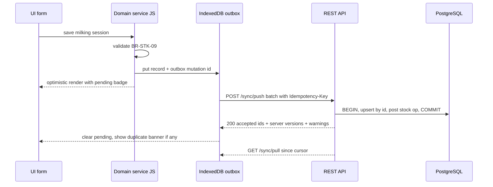
Rules:
1. Client generates UUIDs; server upserts by `id` → retries never duplicate (fixes the multi-phone duplicate problem at the transport level; V242 duplicate *warnings* remain for genuine double recording by two people).
2. Derived postings (stock ops, money tx) are created **server-side** in the same transaction as the source record, keyed by `source_key` (keep BR-STK-05/BR-FIN-03 semantics).
3. Server returns authoritative document numbers; client may display a provisional number with its device code (the V242 format already embeds the device code, so provisional and final can be identical).
4. Reports are computed server-side with a single engine (resolve §10.9).
5. Offline read cache = last pulled state; offline writes = outbox.

### 12.3 Module adapter map
| Current call site | Replace with |
|---|---|
| `window.storage.set(KEY, JSON)` L5560 | per-entity repository + outbox |
| `SFStock.post/reverse` | `POST /stock/*` (server runs the same algorithm) |
| `SFTrade.compute()` | keep client-side for instant preview; authoritative `GET /trade/books` |
| `postLinkedMoneyTx`, `postAccountSettlement` | server-side side-effects of the source record endpoint |
| `can()` | client copy for UI hiding + server enforcement |
| `logEvent()` | server writes `audit_events` (client never trusted) |
| `fetch('/api/ai')` | `POST /api/v1/ai/chat` with bearer token |

---

## 13. Authentication, Roles & Permissions

### 13.1 Current authentication flow
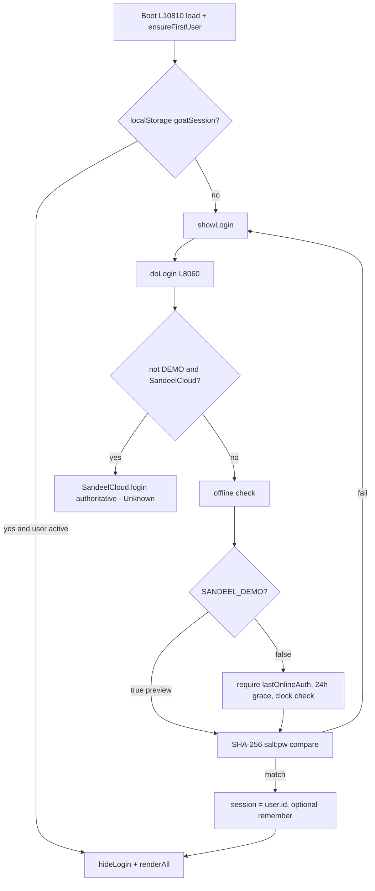

### 13.2 Roles (templates, L5371–5381)
Template codes: `v` = view, `c` = create. **No template grants `edit` or `del`** (comment V147, L5373: "saved records are locked by default for every non-super-admin role"); edit/delete are granted per user in the matrix or via one-time approvals. A module key missing from a template means *no access*.

| Module → / Role ↓ | dash | herd | breed | milk | feed | trade | health | finance | bank | projects | reports | tasks | admin |
|---|---|---|---|---|---|---|---|---|---|---|---|---|---|
| Super admin | all | all | all | all | all | all | all | all | all | all | all | all | all |
| Manager | vc | vc | vc | vc | vc | vc | vc | vc | vc | vc | v | vc | – |
| Farm supervisor | v | vc | vc | vc | vc | **–** | vc | – | **–** | v | v | vc | – |
| Vet / health | v | v | v | – | – | **–** | vc | – | **–** | v | v | vc | – |
| Breeding staff | v | v | vc | – | – | **–** | v | – | **–** | v | v | vc | – |
| Feed / stock | v | v | – | – | vc | **–** | – | – | **–** | v | v | vc | – |
| Accountant | v | v | – | v | v | vc | v | vc | vc | vc | v | vc | – |
| View only | v | v | v | v | v | v | v | – | **–** | v | v | v | – |

Consequence: with templates alone nobody except Super admin can complete a task (`tasks:edit`, OQ-07), reverse a stock op, or delete anything without an approval.
Custom roles (`customUserRoles`, L9785) fall back to the *View only* template unless edited in the matrix.

### 13.3 Permission model
- Matrix: 13 modules × 4 actions (`view`, `create`, `edit`, `del`), per user (`users[].perms`), seeded from role template (`permsFromTemplate` L5382), editable by `admin:edit` (L8256). Unchecking `view` clears other actions.
- `can(mod, act, recordId)` (L5397): no session ⇒ false; inactive ⇒ false; offline sensitive gate (disabled in demo); Super admin ⇒ true; non-view actions require view; then user perms **or** an active one-time approval (`activeOneTimeApproval` L5392) matching module/action/record.
- UI hiding: `applyPermissions()` (L8188) hides nav items, `[data-needs]` elements, delete buttons by selector; v196 MutationObserver re-hides delete controls after re-render.

### 13.4 One-time approvals
`requestApproval()` (L8407) via prompts (module code, edit|del, reason) → `approvalRequests` pending → Super admin approves in Approval Center (`decideApproval` L8428) → valid 30 min → consumed on use (`consumeOneTimeApproval` L5430) by v196 delete guard and `reverseOp` (L14612).

### 13.5 Session
- `session` = user id in memory; remembered via `localStorage.goatSession` **without expiry** (L8166, L10810).
- Logout clears it (`doLogout` L8180).
- No idle timeout, no CSRF concerns today (no server), no token.

### 13.6 Permission gaps (handlers that write without `can()`)
| ID | Handler | Line | Expected perm |
|---|---|---|---|
| GAP-P01 | Add goat `#addBtn` (button hidden by `data-needs`, handler unchecked) | L9836 | herd:create |
| GAP-P02 | Herd bulk "Move to" (all actions) | L9861 | herd:edit / breed:* |
| GAP-P03 | Breeding row actions `[data-bract]`, add doe `#addCross`, heat "Seen today" | L9585, L9945, L9491 | breed:create/edit |
| GAP-P04 | Feed: prices, recipes, plans, fodder pool, stock inline edit, add feed type, delete feed type (`data-delfeed`), feed purchase, stock check, kid diet save/buy powder, v210 recipe source | L5941–7097, L9976, L10002, L10676, L12683, L13097 | feed:create/edit/del |
| GAP-P05 | Season plan edits, batch add/rename/remove | L9384 | breed:edit |
| GAP-P06 | Health: mark vaccines done, give vaccine, add vaccine, vaccine purchase, reminders delete, treatment Recovered | L6765, L10208–10265, L5880 | health:create/edit/del |
| GAP-P07 | Finance: receivable Receive, payable Pay, budget inline edit, asset add/delete (`data-delasset` not in v196 map), recurring add, employee inline edit/delete, profit partners, account remove (`data-ma-remove`), `data-pp-remove`, `data-fsh-remove` | L6515, L6532, L6333, L10154, L6556+ | finance:create/edit/del |
| GAP-P08 | Report tabs dash/profitshare/logistics/alerts/compare need no module permission (profit share shows money) | L10066 | finance:view for money tabs |
| GAP-P09 | Products: catalog add, pricing/route/client price save, quick add product/location/customer via prompts, rename product, transport & cost allocation add | L10266–10332, L14480–14495, L14585 | milk:create/edit, finance:create |
| GAP-P10 | Restore from JSON import (button gated, handler not) | L10399 | admin:edit |
| GAP-P11 | Type-list "＋ Add" entries | L10416 | admin:edit or module edit |
**Conclusion:** client permissions are UX only. **Every rule in §13.3 must be enforced server-side** [Proposed].

### 13.7 Proposed auth [Proposed]
- Argon2id password hashing; minimum 8 chars (configurable); forced change on first login and after reset.
- Short-lived access JWT (15 min) + rotating refresh token (30 days) stored in httpOnly secure cookie (web) or secure storage (PWA); device registration binds `device_code`.
- Offline mode: cached signed "offline grant" valid ≤ 24 h (keeps BR-SYS-06 intent) allowing only non-sensitive creates (keeps BR-SYS-05 intent); deletes/finance/admin require online.
- Server-side permission middleware: `requirePerm(module, action, {recordId})` honours one-time approvals.
- Remove `owner/owner` bootstrap; first owner created by a one-time setup token.

---

## 14. State & Persistence

### 14.1 Stores in use
| Store | Key / name | Content | Writer | Line |
|---|---|---|---|---|
| IndexedDB `sandeelFarms`/`kv` | `goatHerd_v4` | entire farm JSON (85 keys) | `save()` | L5260, L5556 |
| localStorage | `sf:goatHerd_v4` | mirror of the above | storage adapter | L5260 |
| localStorage | `goatHerd_v4_rescue_<ts>` (via storage) | copy of unparsable data | `load()` | L5526 |
| localStorage | `goatSession` | remembered user id | login | L8166 |
| localStorage | `sandeel_device_code` | 3-char device code | SFStock | L13284+ |
| localStorage | `sandeel_v183_kid_milk_diet` (+ v182/v180 fallbacks) | kid diet (duplicate of `kidMilkDiet`) | v183 | L12683 |
| localStorage | `sandeelLastFullBackup` | last export time | backup | L10333 |
| localStorage | `sf232:milkSub`, `sf232:mgMode` | UI state | Products | L13586+ |
| localStorage | `sftd:tab`, `sftd:mtype`, `sftd:basis-b/s`, `sftd:kItem`, `sftd:stmt` | UI state | Trading | L14683 |
| localStorage | `vaMute`, `vaLang` | voice prefs | voice | L11637+ |
| storage (IDB kv) | `autoBackupMeta`, `autoBackupLatest` | backup metadata/fallback | v161 | L11014 |
| IndexedDB `sandeelBackups`/`snaps` | id | up to 8 full snapshots | v161 | L11014 |
| sessionStorage | `bkSnooze` | backup reminder snooze | v161 | L11014 |

### 14.2 Load / save lifecycle
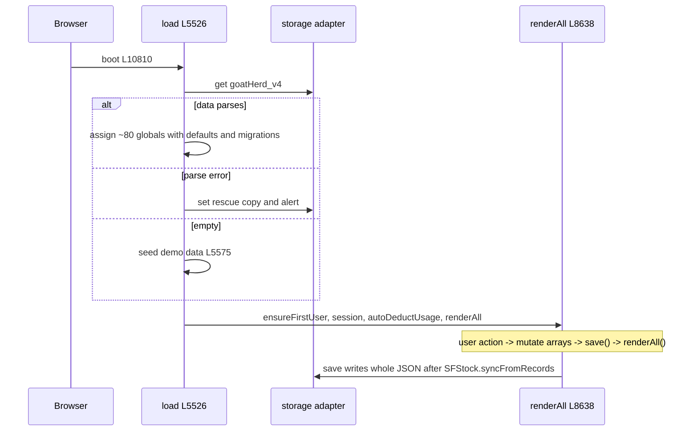

### 14.3 Characteristics & risks
- Whole-document rewrite on every change; size grows with `eventLog` (≤5000), `stockOps`, `feedUsage`, `animalCostLedger` (one row per goat per day) — `animalCostLedger` growth is unbounded (RISK-06).
- `renderAll()` re-renders every module after each change (L8638) — O(total data) per click.
- Migrations are implicit inside `load()` and add-on `ensure*()` functions (V236 maund→kg, V239 parties, V232 `ensureSetup`). No schema version field except `backupVersion:'V150'` in exports.
- Concurrency: two tabs/devices overwrite each other's whole document (last write wins) — no merge.

### 14.4 Proposed persistence [Proposed]
- Server: PostgreSQL (§8) as source of truth.
- Client: IndexedDB with per-entity object stores + `outbox` store + `meta` (cursor, device code, schema version). Retain the `window.storage` adapter interface as the seam.
- Explicit numbered migrations both server (SQL) and client (IDB `onupgradeneeded`).

---

## 15. Import, Export, Reporting & Printing

### 15.1 Imports
| Import | Trigger | Format & rules | Line | Status |
|---|---|---|---|---|
| Herd CSV | `#csvBtn` → `#csvFile` | Header row; `tag` column required (aliases tag, tag id, id, rfid); optional name, breed, sex/gender, status, date (date_in/dob/born/bought), price/cost, owner, dam/mother, sire/buck/father, note/comment; DD/MM/YYYY → ISO; date required; duplicate tags vs all goats & within file rejected; source = price>0 ? bought : born; dam linking incl. same file; preview confirm; `logEvent('import')` | `parseCsv`/`importHerdCsv` L10582 | [Implemented] (handler no `can()`, GAP) |
| Full restore | `#importBtn` → `#importFile` | JSON must contain `goats` array; strips `backupVersion`/`_savedAt`; writes whole store; reload; **no schema validation** | L10399 | [Partial] |
| Auto-backup restore | Backup Center row | safety backup first, then same as restore | L11014+ | [Implemented] |

### 15.2 Exports
| Export | File name | Content | Line | Status |
|---|---|---|---|---|
| Full JSON | `SandeelFarms_FullBackup_<date>.json` | `snapshot()` = all collections + type lists + `backupVersion:'V150'` + `_savedAt` | L10346 | [Implemented] |
| Herd CSV | `herd…csv` | uses `motherId/fatherId` — fields don't exist ⇒ empty (should be damTag/sireTag) | L10333+ | [Partial] DEF-08 |
| Finance CSV | | incomes, expenses, feed buys, vaccine buys, milk sales, product sales (**incl. cancelled**), salaries, owner funding, fodder | | [Partial] |
| Feed CSV | | feed purchases/stock | | [Implemented] |
| Health CSV | | uses `x.vaccine`/`x.name` but `vaccLog` stores `vaccineId` ⇒ empty names | | [Partial] DEF-08 |
| Breeding CSV | | legacy field names (`doeTag` etc.) ⇒ mostly empty | | [Partial] DEF-08 |
| Tasks CSV | | `dueDate` (field is `due`), assignee id not name | | [Partial] DEF-08 |
| Audit CSV | `#auCsv` | filtered eventLog with BOM | L9822 | [Implemented] |
| P&L CSV | `#plCsv` | P&L rows | L10425+ | [Implemented] |
| Reports CSV | `#repCsv` | **scrapes rendered DOM** (KPI cards, trend `window.__trend`, ~28 tables) | L10084 | [Implemented] (fragile) |
| Stock ledger CSV | `sandeel-stock-movements-<date>.csv` | filtered ops × lines | L14446 | [Implemented] |
| Breed performance CSV | | v212 table | L13206 | [Implemented] |
| Trading register CSV | `sandeel-trading-<date>.csv` | all entries incl. cancelled with status | L15119 | [Implemented] |

CSV writer conventions: values with `",\n` quoted and `"` doubled; some include UTF-8 BOM (`downloadCSV`), stock/trading do not.

### 15.3 Reports (Reports view)
Period: today, week (Mon start), month-to-date, last month, 3 m (90 d), 6 m (180 d), year, all, custom (`repRange` L7129). Grouping day/week/month (trend limited to 90/53/36 rows). 16 tabs listed in §5.3. KPIs and ratio thresholds: mortality %, pregnancy % (≥70 good), kids per doe, feed cost/goat/day, feed cost/litre (>60 red), health cost/goat (L7483).

### 15.4 Printing
`#repPrint` shows all report tabs, adds `body.printing`, calls `window.print()` (L10084+). No dedicated invoice/receipt print for product sales or trading bills — **[Proposed]** printable invoice (SF-…) and trading bill (TR-…) templates with Urdu/English labels.

---

## 16. Validation, Error Handling & Reliability

### 16.1 Validation style
- Imperative checks in handlers; errors via `alert()`; questions via `confirm()`/`prompt()`/`ask()` modal (L5672).
- V232/V235 modules use `run(btn, fn)` wrappers: busy lock (prevents double-click double posting), button disabled, thrown `Error` → `alert`, success → save + render + toast (L13586+, L14787).
- v194 capture-phase guard adds cross-record duplicate checks (BR-FIN-09).
- HTML `required`/`min` attributes are mostly not relied upon.

### 16.2 Error handling
| Area | Behaviour | Line |
|---|---|---|
| Storage write failure | red "save failed" bar (`saveFailed`) | L5282 |
| Corrupt stored JSON | rescue copy + alert, then continue | L5526 |
| Stock sync failure | `console.error`, save continues | L5558 |
| Products render failure | caught, `console.error`, screen may be partially empty | L14658 |
| AI endpoint down / not configured | fallback to local `basic()` parser | L12204–12244 |
| Network calls E1/E2 | errors swallowed | L8424, L8435 |
| `logEvent` failures in add-ons | wrapped in try/catch and ignored | many |

### 16.3 Reliability features present
Idempotent linked postings (BR-FIN-03), unique `sourceKey` (BR-STK-05), reversals instead of deletes (BR-STK-07, BR-TRD-12), integrity check (BR-FIN-21), stock reconciliation (BR-STK-21), V242 duplicate alerts (BR-STK-20), weekly auto-backup (BR-SYS-08), AI duplicate guard + undo (BR-SYS-09), opening balance lock (BR-FIN-06).

### 16.4 Defect register (documented, **not fixed** in this task)
| ID | Severity | Defect | Line | Evidence |
|---|---|---|---|---|
| DEF-01 | High | Breeding row action "Entered by mistake" references `st`, which is only declared inside the `rows.map` callback of the table renderer ⇒ `ReferenceError` for any goat (the very first statement of that branch reads `st`), so the action never works | L9616 (decl. L9345) | static scope + runtime `typeof st === 'undefined'` |
| DEF-02 | Medium | `actYoungGraduate` sends "meat" class to status `buck` | L8878+ | code |
| DEF-03 | Low | Legacy V124/V126 renderers write to 18 element IDs that no longer exist (e.g. `slaughterRows`, `warehouseRows`, `dairyKpis`, `productSaleRows`) — dead code that still runs | L6899–6938, L10285–10300 | grep count 0 |
| DEF-04 | Medium | Kidding dialog collects *ease* and *note* but does not store them (AI `recordKidding` stores note) | L9214 | code |
| DEF-05 | High | Manual add allows reusing the tag of a dead/sold goat (`findGoatByTag` live-only) while other paths forbid it | L9945, L9836 | code |
| DEF-06 | Medium | `applyPermissions()` runs before modules render and uses stale selectors (`data-delfb`, `data-delvb`, `data-delvac`) — relies on v196 observer to compensate | L8188, L8638 | code |
| DEF-07 | Medium | Feed purchases store the feed **display name**; matching by name breaks after renaming a feed | L6939, L10002 | code |
| DEF-08 | Medium | CSV exports (herd, health, breeding, tasks) reference non-existent fields ⇒ empty columns | L10333–10398 | code |
| DEF-09 | Medium | Cash flow counts vaccine purchases at full amount even when partly unpaid | L6286 | code |
| DEF-10 | High | Dashboard month table, finance overview trend, comparison report and `farm.finance` v0.35 use a legacy income engine that excludes product sales and invoices | L6127, L8471, L8012, L10709 | code |
| DEF-11 | Medium | Cancelled product sales included in working capital, trend, day-by-day, monthly-closing AR and AI receivePayment FIFO | L7156, L7274, L7353, L12522, L11136+ | code |
| DEF-12 | Medium | Deleting a project leaves its capex rows orphaned | L10063 | code |
| DEF-13 | Medium | Cost allocation creates an expense with no money account ⇒ cash flow and account balances diverge | L10331 | code |
| DEF-14 | Medium | Capex, fixed asset, capex payment, transport, customer invoice, payable initial paid, manual bank out/transfer push `accountTx` without balance check (contradicts BR-FIN-02) | L10060–10063, L10328, L10487–10503 | code |
| DEF-15 | Medium | Payable "Pay" has no `can()` and no balance check | L6532 | code |
| DEF-16 | Medium | Balance sheet cash is derived from cash flow (not account balances) and omits stock-ledger inventory value | L6332 | code |
| DEF-17 | Low | Recurring costs assumed paid in cash flow; months approximated as days/30.44 | L6226, L6286 | code |
| DEF-18 | Low | Dead handlers `[data-cross]`, `[data-unprep]`, `[data-kidded]`, `[data-uncross]`; dead v168 `renderDashboard` branch; dead CSS selectors (v223/v217) | L9660, L12380, L13264 | grep |
| DEF-19 | Low | Voice vocabulary maps feed aliases to keys that do not exist (`silage`, `lucerne`, `hay`) | L11136+ | code |
| DEF-20 | Low | Report "total goats" excludes unweaned kids ⇒ per-goat ratios overstated | L7483 | code |
| DEF-21 | Low | Profitability "goat sales" only matches income text against the regex /goat or meat/ — excludes `sales[]` and meat product sales | L7882 | code |
| DEF-22 | Low | Loans are not linked to money accounts (liability without cash) | L10425 | code |
| DEF-23 | Low | Prefix `TR-` is used by three schemes: stock transfer op no. (`TR-YYYYMMDD-DEV-NNN`), trading bill (`TR-YYYYMM-DEV-NNN`), transport ref (`TR-`+timestamp) | L13284+, L14843, L10328 | code |
| DEF-24 | Medium | Remembered session never expires | L8166, L10810 | code |
| DEF-25 | Medium | AI action permissions differ from UI permissions for 4 actions | L11136+ | code |
| DEF-26 | Low | AI `buyVaccine` payable type "Vaccine purchase" vs UI "Vaccine / medicine" (different grouping / guard) | L11136+, L10208 | code |
| DEF-27 | Low | Auto feed deduction catches up ≤120 days; kid diet ≤370 days — longer gaps silently skipped | L6989, L12683 | code |
| DEF-28 | Low | Stock check logs shortfalls only; surpluses unlogged | L10676 | code |
| DEF-29 | Low | `id()` = 7 random base-36 chars from `Math.random` (collision probability non-trivial at scale; not crypto) | L5573 | code |
| DEF-30 | Low | Top bar shows hard-coded "Sargodha, Pakistan" | L9831 | code |
| DEF-31 | Low | Kid milk diet persisted twice (main KEY and its own localStorage key) — can diverge across devices/restores | L12683 | code |
| DEF-32 | Low | `acc-quick 'lm'` range computed three times, last assignment wins | L10425+ | code |

### 16.5 Proposed reliability measures [Proposed]
Server-side validation mirroring every BR; DB constraints (§8.5); idempotency keys; transactional derived postings; structured error codes; Sentry-style client error reporting; nightly server backups + point-in-time recovery; integrity check as a scheduled job.

---

## 17. Security, Privacy & Audit

### 17.1 Current posture (facts)
| Topic | Finding | Line |
|---|---|---|
| Trust boundary | None — all logic and data on the device; anyone with devtools can edit any record or permission | — |
| Passwords | SHA-256(`salt:password`), 12-byte random salt, hex; no stretching | L5442 |
| Default credentials | `owner/owner` created on first run | L8045 |
| Password policy | ≥4 chars on change; none on create/reset | L9813, L9798 |
| Session | user id in localStorage, no expiry, no binding | L8166 |
| Data at rest | Plain JSON in IndexedDB/localStorage (login screen states it is "not data encryption") | L2918, L8283 |
| Export | Full JSON (incl. users' salt+hash) downloadable by admin | L10346 |
| AI data sharing | System prompt sends farm context (≤80 tags, staff names, accounts, suppliers, customers, products) to `/api/ai`; request has **no auth** | L12204+ |
| Query API | `farm.query` hides salt/hash/perms/sessionToken | L11136+ |
| XSS | `esc()`/`H()` used for user text in templates; some `innerHTML` built from data — review needed in rebuild | L5672 |
| Audit | `eventLog` (≤5000, oldest dropped) records user, action, entity, detail, AI channel/transcript; client-written (tamperable) | L5442 |
| Demo flags | `SANDEEL_DEMO=true` weakens offline gates | L12933 |

### 17.2 Privacy data inventory
Personal data: user names/usernames, employee names & salaries, customer/supplier names & phones & places (Trading parties), buyer names (goat sales), partner/shareholder names & funding, bank account notes (e.g. "HBL … ****1234").

### 17.3 Proposed controls [Proposed]
1. Server-side authZ on every endpoint (module/action/record) incl. AI tool calls.
2. Argon2id, 8+ char policy, lockout/backoff, forced first-login change, no default credentials.
3. TLS everywhere; httpOnly refresh cookie; access token in memory.
4. AI proxy holds provider key; strips/limits PII in context; logs prompts/tool calls to `ai_action_log` with user id; rate-limit per user.
5. Append-only `audit_events` written by server (never trust client logs); retention ≥ 7 years for finance.
6. Exports exclude credential hashes; admin-only; audited.
7. Backups encrypted at rest; restore requires schema validation and Super admin + re-auth.
8. Content-Security-Policy (self + Google Fonts), no inline event handlers in rebuild.
9. Remove `SANDEEL_DEMO` and demo banner from production build (keep only in LOCAL-PREVIEW).

---

## 18. Non-Functional Requirements

| ID | Requirement | Current | Target [Proposed] |
|---|---|---|---|
| NFR-01 Offline | Must work with poor/no connectivity on farm | Fully offline (local only) | Offline-first PWA with outbox; sync when online |
| NFR-02 Multi-device | Several phones record simultaneously | Not supported (whole-doc overwrite); V242 adds device codes + duplicate warnings | Idempotent sync, per-record versions, conflict UI |
| NFR-03 Performance | Interaction < 200 ms on mid-range Android | full `renderAll` per change; JSON grows unbounded | render only active view; paginate; server aggregates |
| NFR-04 Data volume | 5 years, ~300 goats, 2 milkings/day | `animalCostLedger` ≈ goats × days rows | server tables + monthly summaries |
| NFR-05 Mobile UX | Large touch targets, 16 px inputs | v160 responsive (40 px targets, safe-area, reduced motion), v205 feed tables | keep |
| NFR-06 Language | Urdu/Punjabi/English | English UI, Urdu/Roman voice vocabulary, desi number parser | i18n for UI labels (ur, en) |
| NFR-07 Units/currency | Rs, kg, L, maund | hard-coded | farm settings |
| NFR-08 Availability | Data never lost | local only + weekly local backup | server backups, PITR, RPO ≤ 15 min |
| NFR-09 Security | §17 | client-only | §17.3 |
| NFR-10 Auditability | Every money/stock change traceable | eventLog + ledgers | server audit + immutable ledgers |
| NFR-11 Accessibility | Usable by farm staff | some `role="alert"`, `aria-*` in V232/V235 | WCAG 2.1 AA for core flows |
| NFR-12 Time zone | Asia/Karachi | local browser date (`ymd` local) | store DATE in farm TZ, timestamps UTC |
| NFR-13 Browser | Chrome Android, desktop Chrome/Edge | ES2017, IndexedDB, Web Speech optional | same |

---

## 19. Existing Application Integration & Code Mapping

### 19.1 What could and could not be verified
- **Supplied for this task:** only `index.html` (the V242 *LOCAL-PREVIEW* build). The production repository was **not** supplied, so its structure and code **cannot be verified here**.
- **Secondary evidence (project notes, not code):** the claude.ai project docs `V232-products-stock-ledger.md` and `V242-phone-codes-and-double-entry.md` describe a production package `Sandeel-Farms-Railway` with:
  - an **ASP.NET Core** backend: `Program.cs`, `Services/AuthService.cs`, `SyncService.cs`, `FarmDataService.cs`, `ApprovalService`, `DatabaseMigrator.cs`, `SyncModels.ServerRev`;
  - **PostgreSQL** migrations `V1…V7`, e.g. `V4__Stock_Ledger_and_Payloads.sql`, `V6__Double_Entry_Accounting.sql`, `V7__Sync_Fixes.sql`; these add a `payload JSONB` column to every farm table and a `stock_operations` table with a unique `source_key`;
  - a cloud frontend built from `SOURCE/` by `patch.py` and `offline_patch.py`, which injects the `SandeelCloud` client that this preview lacks;
  - `sw.js` and `manifest.webmanifest`, with deployment on Railway via a `Dockerfile`.

  These notes also report the following endpoints. They are **not** in this HTML:

  | Area | Reported endpoints |
  |---|---|
  | Sync, auth and farm data | `/api/sync/*`, `/api/auth/*`, `/api/farm/*` |
  | Reports | `/api/reports/*`, including `/api/reports/stock/balances` |
  | AI | `/api/ai` (the notes say it requires sign-in) |
  | Health | `/health` |

  The same notes report sliding sessions: 7 days of use, at most 30 days.
- Treat all of the above as **[Reported — requires verification against the repository]**.

### 19.2 Consequences for Cursor
1. **Do not build the §8 schema or §11.3 API from scratch.** First inspect `Migrations/`, `FarmDataService.cs` and `SyncService.cs`, and map each §7 entity to the table that already exists. The §8 model is a *reference target*, used to judge gaps such as constraints, FKs and the server-side stock check.
2. The production client is the same `index.html` plus the `offline_patch.py` cloud client. Behaviour described here as "preview" (`SANDEEL_DEMO`, `owner/owner`, inert `#conflictModal`) differs in the cloud build.
3. Change the **source modules** (`SOURCE/engine.js`, `ui.js`, `trading.js`, `style.css`) and regenerate the HTML with `patch.py`. Do not hand-edit the generated `index.html`, if the repository confirms this build flow.

### 19.3 Recommended layering (ASP.NET Core, if confirmed)
| Layer | Responsibility | From this document |
|---|---|---|
| Domain entities | Goat, Mating, Kidding, StockOperation/StockLine, ProductSale, MoneyAccount/AccountTransaction, TradeEntry… | §7, §8 |
| Application services | Herd, Breeding, Feed, Stock (port of SFStock), Sales, Accounting, Trading (port of SFTrade.compute), Reports (single P&L engine) | §10 rules |
| Infrastructure | EF Core or existing Dapper/ADO in `FarmDataService`; migrations `V8+` only, never edit applied migrations | §8.5, §8.6 |
| API | existing endpoint conventions (`/api/farm/*`, `/api/sync/*`) first; new endpoints only when missing | §11 |
| DTOs and validation | FluentValidation or DataAnnotations mirroring BR-* | §10, §16 |
| Auth | existing `AuthService`; add server-side `requirePerm(module, action, record)` | §13 |
| UI | existing `SOURCE/*.js`; keep IDs and `data-*` attributes stable for tests | §5, §6 |
| Tests | Playwright (already used: tests `a1–a3`, `o1–o7`, `t2–t14` per notes) + xUnit for services | §20 |

### 19.4 Feature-to-code mapping (for Cursor to fill in or verify)
| Feature | HTML function (line) | Repo file (reported) | Server entity or table (reported/verify) | Endpoint (reported/verify) | Status |
|---|---|---|---|---|---|
| Milking session | `saveMilking` (L13766) | SOURCE/ui.js | milking_sessions | /api/sync/* | Requires verification |
| Stock ledger post/reverse | `SFStock.post/reverse` (L13284+) | SOURCE/engine.js | stock_operations, stock_balances view | /api/reports/stock/balances | Requires verification |
| Server-side stock check | — | — | — | — | Not found (open item per notes) |
| Product sale | `postSale` (L14311) | SOURCE/ui.js | product_sales (invoice_no unique, cogs, cancelled) | /api/sync/* | Requires verification |
| Device code / numbering | `deviceCode`, `nextNo` | SOURCE/engine.js, trading.js | — | — | Requires verification |
| Duplicate warning | `dupGroups` (L14623) | SOURCE/ui.js | — | — | Requires verification |
| Trading books | `SFTrade.compute` (L14725) | SOURCE/trading.js | tradeRecs table? | /api/sync/* | Requires verification |
| Money accounts and tx | `postLinkedMoneyTx` (L6474) | index main script | account_transactions (account_id FK) | /api/sync/* | Requires verification |
| Double-entry ledger | — | Migrations/V6 | V6 tables, trial balance | /api/farm/* | Reported "not used by the app yet" |
| Approvals | `requestApproval`, `decideApproval` (L8407–8438) | ApprovalService | approval table? | /api/approvals/* | Requires verification |
| AI assistant | `callAI` (L12204) | Program.cs | — | /api/ai | Requires verification |
| Login | `doLogin` (L8060) | AuthService.cs | users/sessions | /api/auth/* | Requires verification |
| Auto backup | v161 (L11014) | — | — | SANDEEL_BACKUP_ENDPOINT | Not found server-side |
| Herd, breeding, feed, health, projects, reports | main script | index main script | payload tables? | /api/sync/* | Requires verification |

---

## 20. Testing Strategy

Legend: **[Obs]** = test derived from behaviour observed in `index.html` (regression baseline); **[Prop]** = test for proposed backend behaviour.

### 20.1 Domain and business rules
| Test ID | Rule | Case | Expected | Type |
|---|---|---|---|---|
| T-BRD-01 | BR-BRD-01 | mated 2026-05-01 | due 2026-09-28 | Obs |
| T-BRD-02 | BR-BRD-03 | female, 299 days old | not eligible; 300 days → eligible | Obs |
| T-BRD-03 | BR-BRD-05 | cross a doe with her sire | relation high, confirm required | Obs |
| T-BRD-04 | BR-BRD-06 | batch kid window 09-01..09-15, today 2026-10-29 | next window 2027; crossFrom = 2027-04-04 | Obs |
| T-BRD-05 | BR-BRD-15 / DEF-01 | choose "Entered by mistake" | currently throws ReferenceError (regression documents the defect); after fix, clears mating | Obs→fix |
| T-BRD-06 | BR-BRD-13 | kidding alive 9 | rejected (≤8) | Obs |
| T-HERD-01 | BR-HERD-02 / DEF-05 | add tag of a sold goat | currently allowed; target: rejected | Obs→fix |
| T-HERD-02 | BR-HERD-07 | kid 80 days old, 13.2 kg | wean due | Obs |
| T-HERD-03 | BR-HERD-06 | set a goat's own kid as its dam | rejected | Obs |
| T-HLT-01 | BR-HLT-02 | repeat 6 months, last dose 2026-04-01 | due 2026-09-28 | Obs |
| T-FEED-01 | BR-FEED-01/02 | recipe 60% wanda@100, 40% binola@150; mix 1 kg | mix cost 120 Rs/kg | Obs |
| T-FEED-02 | BR-FEED-09 | lastUsageDate 200 days ago | only 120 days deducted (DEF-27) | Obs |
| T-STK-01 | BR-STK-02 | in 100 L @0, in 50 L value 1500; out 30 L | out value 300 (avg 10/L) | Obs |
| T-STK-02 | BR-STK-04 | sell 31 L from a 30 L tank | STOCK_SHORTAGE | Obs |
| T-STK-03 | BR-STK-05 | save twice, same session | one receipt op | Obs |
| T-STK-04 | BR-STK-15 | 24 kg carcass, value 12,000; cuts 10+8+4 kg by weight | values 5,454.55 / 4,363.64 / 2,181.81 (remainder last) | Obs |
| T-STK-05 | BR-STK-20 | two sessions "Morning" 2026-10-29 from two devices | banner shows 2 items; keep sets dupOk on both | Obs |
| T-SALE-01 | BR-SALE-06 | partial with received = amount | rejected | Obs |
| T-SALE-02 | BR-SALE-10 | cancel paid sale, restock | stock back, refund settlement out, sale cancelled | Obs |
| T-TRD-01 | BR-TRD-04/05/06 | buy 4000 kg @620/maund, freight 3500, labour 1200; sell 1000 kg @700/maund | COGS = 1000 × (62,000+4,700)/4000 = 16,675; profit = 17,500 − 16,675 − freight | Obs |
| T-TRD-02 | BR-TRD-08 | back-dated sell before buy | refused (negative at that date) | Obs |
| T-TRD-03 | BR-TRD-14 | any dataset | balance check ✓ | Obs |

### 20.2 Financial calculations
| Test ID | Rule | Case | Expected | Type |
|---|---|---|---|---|
| T-FIN-01 | BR-FIN-01 | opening 1,000; in 500; out 200; transfer out 100 | balance 1,200 | Obs |
| T-FIN-02 | BR-FIN-02 | expense 1,500 from an account holding 1,200 | blocked | Obs |
| T-FIN-03 | BR-FIN-03 | `postLinkedMoneyTx` called twice | one transaction | Obs |
| T-FIN-04 | BR-FIN-13 | recurring 120,000/yr, range = 1 month | ≈10,000 × monthsIn | Obs |
| T-FIN-05 | §10.9 | same month across P&L, dashboard and comparison | currently differ (DEF-10); target: equal | Obs→fix |
| T-FIN-06 | DEF-11 | cancelled sale | excluded from AR everywhere | Prop |
| T-FIN-07 | BR-FIN-17 | net −5,000 | distributable 0 | Obs |
| T-FIN-08 | BR-FIN-11 | employee joins 15th of month | full salary that month (no proration); decision OQ-05 | Obs |

### 20.3 Database constraints and relationships [Prop]
| Test ID | Case | Expected |
|---|---|---|
| T-DB-01 | duplicate `(farm_id, lower(tag))` | rejected |
| T-DB-02 | duplicate `source_key` | rejected |
| T-DB-03 | duplicate `invoice_no` (case-insensitive) | rejected |
| T-DB-04 | transfer to the same account | rejected |
| T-DB-05 | second open mating for a doe | rejected |
| T-DB-06 | stock line `qty = 0` | rejected |
| T-DB-07 | delete a project with capex | RESTRICT |
| T-DB-08 | account transaction for a non-existent account | FK error (the V242 `account_id` bug class) |

### 20.4 API validation and authorization [Prop]
| Test ID | Case | Expected |
|---|---|---|
| T-API-01 | every POST replayed with the same Idempotency-Key | same result, one row |
| T-API-02 | 422 on each BR validation (field-level) | — |
| T-AUTH-01 | role template matrix (§13.2) × each endpoint | 403 where not granted |
| T-AUTH-02 | GAP-P01…P11 handlers called directly | 403 server-side |
| T-AUTH-03 | one-time approval | used once; expired after 30 min |
| T-AUTH-04 | AI tool call to a write action without the permission | 403 |
| T-AUTH-05 | disable the last Super admin | refused |
| T-AUTH-06 | `/api/ai` without a session | 401 |

### 20.5 Navigation, forms and modals [Obs]
- Each `.nav-i[data-view]` opens its view; a user without view permission is redirected to `firstAllowedView`.
- Products tabs and sub-panes; Trading tabs persist across reloads (`sftd:tab`).
- Goat modal: open from row, scan box and nested links; closes on backdrop and close button.
- Trading dialog: Escape and backdrop close it; "＋ Add new…" selects the new record after save.
- Sale review: changing qty, rate or type hides the review panel.

### 20.6 Import and export
- [Obs] Herd CSV: aliases, DD/MM/YYYY, duplicates in the file rejected, dam linking within the same file.
- [Obs] JSON round trip: export → wipe → import gives the same `snapshot()` minus `_savedAt`.
- [Obs→fix] CSV exports contain non-empty dam/sire, vaccine names and task due dates (DEF-08).
- [Prop] Import schema validation rejects malformed files without touching data.

### 20.7 Reporting and persistence
- [Obs] Reports CSV includes each visible table.
- [Obs] Print sets `body.printing`.
- [Obs] Reload preserves all 85 keys; corrupt JSON creates a rescue copy.
- [Prop] Server report endpoints match the client calculations in §20.1/§20.2 on a fixed fixture.

### 20.8 Responsive [Obs]
- Widths 390 px and 768 px: no horizontal page scroll.
- Inputs ≥16 px; touch targets ≥40 px (v160).
- Feed tables scroll with a sticky first column (v205).

### 20.9 Regression
- Run the V232/V233/V242 scenario lists from the project notes (tests A–N, `a1–a3`, `o1–o7`, `t2–t14`) on every change to stock, sales, trading or sync.

### 20.10 Critical end-to-end workflows
| WF | Steps | Records created or updated |
|---|---|---|
| WF-1 Milk to cash | record milking → pasteurize → make yogurt → sell on credit → receive later | milkingSessions, milkProd, stockOps (MR, PZ, DP, SO), expenses, productSales, accountTx (initial + settlement), settlements, eventLog |
| WF-2 Goat to cuts | slaughter goat → split → cut → sell cuts | slaughterBatches, goat archived, stockOps (SL, SP, CT, SO), expenses (fees), productSales, accountTx |
| WF-3 Breeding cycle | prep → cross → scan → kidding → tag kids → wean | goats (doe fields), kiddings, new kid goats, emptyLog/abortions, eventLog |
| WF-4 Feed purchase | buy on credit → auto daily use → pay supplier | feedBuys, supplierPayables, feedStock, feedUsage, animalCostLedger, settlements, accountTx |
| WF-5 Trading | add capital → buy → sell partly on credit → receive → P&L/BS | tradeRecs entries, parties |
| WF-6 Approval delete | staff requests delete → Super admin approves → staff deletes within 30 min | approvalRequests, deletion, eventLog (approval_used, delete) |
| WF-7 Multi-phone | two phones record the same Morning milking offline → sync → duplicate banner → delete one | milkingSessions (device), stockOps reversal |

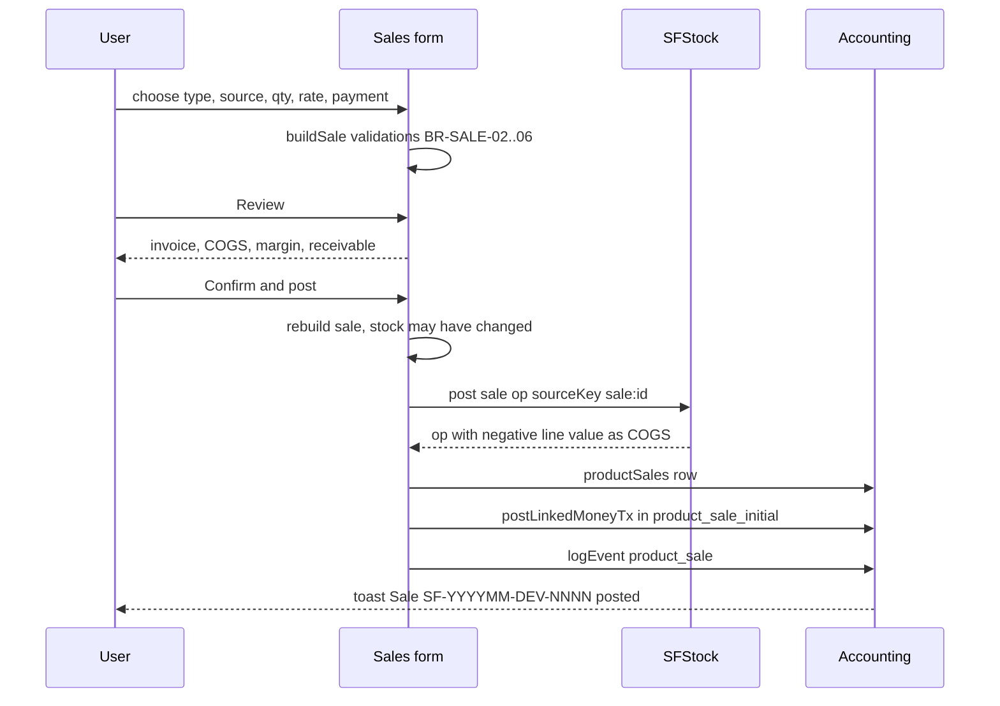
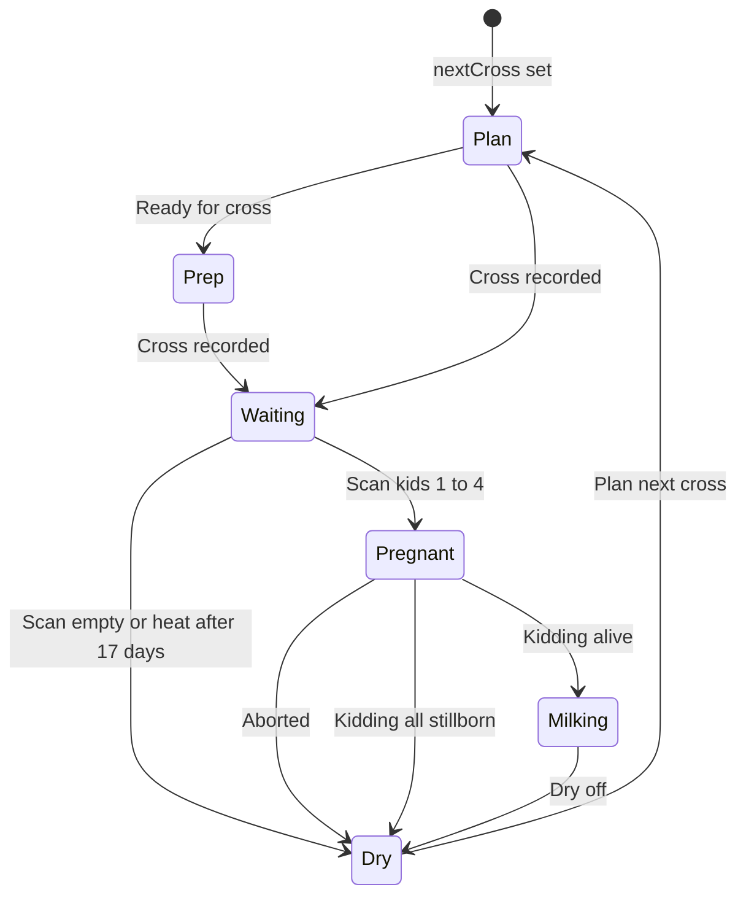
```mermaid
flowchart LR
  CAP[Money put in] --> ACC[(Trading cash and bank)]
  ACC -->|paid + kiraya + labour| BUY[Buy entry]
  BUY --> STK[(Godown stock at landed avg cost)]
  BUY --> SUP[Supplier owed goods minus paid]
  STK -->|avg cost| SELL[Sell entry]
  SELL -->|received minus delivery| ACC
  SELL --> CUS[Customer owes amount minus received]
  STK --> LOSS[Loss or count adjust]
  ACC --> PAYREC[Pay supplier or receive customer]
  SELL --> PL[P and L gross and net]
  LOSS --> PL
```

---

## 21. Implementation Roadmap [Proposed]

Priority order: data integrity → preserve working features → security → consolidation. **No big-bang rewrite.**

| Phase | Objectives | Modules | Dependencies | DB work | Backend work | UI work | Security | Tests | Acceptance | Risks / prerequisites |
|---|---|---|---|---|---|---|---|---|---|---|
| P0 Verify | Confirm the repo matches §19.1; baseline | all | repo access | dump schema; map §7 to tables | list endpoints | none | none | run existing Playwright suites | gap list approved by owner | repo differs from the notes |
| P1 Integrity fixes | Fix DEF-01, 02, 04, 05, 08, 11, 15 (low-risk, high-value) | Breeding, Herd, Finance, Export | P0 | none | none | SOURCE js | none | T-BRD-05, T-HERD-01, T-FIN-06, T-DB-01 | regression suites green | owner sign-off on DEF-02 intent |
| P2 Server-side stock check | Lock balances; reject negative (open item G) | Stock, Sales | P0 | index or constraint on stock_balances; advisory lock per key | `SyncService` validation | conflict message | — | concurrent-sale test | two phones selling the last litres: one rejected | offline UX for rejection |
| P3 Server authorization | Enforce §13 for every synced mutation and AI tool | all | P0 | role_permissions | middleware; unify AI perms (DEF-25) | hide = cosmetic | close GAP-P01..P11 | T-AUTH-* | direct calls 403 | users losing rights they used before |
| P4 Single finance engine | One P&L, cash and AR engine (§10.9) server-side; UI reads it | Finance, Reports, Dashboard | P3 | views/materialised summaries | report endpoints | replace legacy engine calls | finance:view | T-FIN-05 | dashboard = P&L = comparison | owner decisions OQ-03…06 |
| P5 Ledger hardening | Balance checks everywhere (DEF-14), cost allocation with account (DEF-13), loans to accounts (DEF-22), BS from balances + stock (DEF-16) | Finance, Projects | P4 | FK + checks | services | forms | — | T-FIN-* | integrity check 0 issues on fixture | historical data cleanup |
| P6 Auth hardening | Argon2id, policy, remove owner/owner, session expiry (DEF-24) | Auth | P3 | users | AuthService | first-run setup | §17.3 | T-AUTH-05/06 | pen-test checklist | user retraining |
| P7 Data model normalisation (optional) | Move goat breeding fields to matings; sire FK; feed movements ledger | Herd, Breeding, Feed | P1–P5 | V8+ migrations with backfill | services | none visible | — | migration tests | reports unchanged before vs after | migration risk; payload JSONB compatibility |
| P8 UX and i18n | Hash routes, printable invoice/bill, Urdu labels | UI | P4 | — | PDF endpoint optional | — | — | nav tests | owner acceptance | — |

### 21.1 Deployment architecture
```mermaid
flowchart LR
  subgraph Devices
    P1[Phone A PWA with device code]
    P2[Phone B PWA]
    PC[Office PC browser]
  end
  subgraph Railway_reported[Railway - reported by project notes, verify]
    APP[ASP.NET Core app serves index.html sw.js and API]
    DB[(PostgreSQL)]
  end
  AI[AI provider via server-side key - proposed]
  BK[(Encrypted backups - proposed)]
  P1 -->|HTTPS sync push pull| APP
  P2 -->|HTTPS| APP
  PC -->|HTTPS| APP
  APP --> DB
  APP --> AI
  DB --> BK
```
Labels: Railway, ASP.NET Core and PostgreSQL come from project notes (**[Reported]**). The AI key custody and encrypted backups are **[Proposed]**.

---

## 22. Traceability Matrix

`Source element → UI feature → JS function → Business rule → Entity/table → API endpoint → Test`

| Source element (line) | UI feature | JS function | Rule | Entity / table | API endpoint | Test |
|---|---|---|---|---|---|---|
| `#lg-go` (L2918) | Login | `doLogin` (L8060) | BR-SYS-01/06 | users | `/api/auth/*` (Reported; requires verification) | T-AUTH-05/06 |
| `#addBtn` (L3196+) | Add goat | handler (L9836) | BR-HERD-01/02/04 | goats | Proposed `POST /goats` | T-HERD-01 |
| `#csvBtn` (L2943+) | Herd CSV import | `importHerdCsv` (L10582) | BR-HERD-03 | goats | Proposed `POST /goats/import` | §20.6 |
| `[data-bract]` (L9585) | Breeding stage change | inline handler | BR-BRD-11..15 | goats → matings | Proposed `POST /matings/*` | T-BRD-05 |
| `#bg-create` (L3291+) | Breeding group | v206 `create` (L12992+) | BR-BRD-18 | breeding_groups | Proposed | Requires verification |
| goat card "Kidding" | Record birth | `doKidding` (L9214) | BR-BRD-13 | kiddings, goats | Proposed `POST /matings/{id}/kidding` | T-BRD-06 |
| `#giveVacc` (L5126+) | Vaccinate group | handler (L10234) | BR-HLT-01..03 | vaccLog → vaccinations | Proposed | T-HLT-01 |
| `#addFeedBuy` (L3452+) | Feed purchase | handler (L10002) | BR-FEED-06/07/08 | feedBuys, supplierPayables, accountTx | Proposed `POST /feed-purchases` | T-FIN-03 |
| feed auto use | Daily deduction | `autoDeductUsage` (L6989) | BR-FEED-09 | feedUsage → feed_movements | Not applicable (server job proposed) | T-FEED-02 |
| `#sl-mg-save` (L3690+) | Record milking | `saveMilking` (L13766) | BR-STK-09, BR-STK-05 | milking_sessions, stock_operations | `/api/sync/*` (Reported) | T-STK-03 |
| `#sl-pz-save` | Pasteurize | `savePasteurize` | BR-STK-10 | stock_operations, expenses | Proposed `/stock/pasteurize` | Requires verification |
| `#sl-sg-save` (L3873+) | Slaughter | `saveSlaughter` | BR-STK-13 | slaughter_batches, stock_operations | Proposed `POST /slaughters` | WF-2 |
| `#sl-ct-save` | Cut carcass | `saveCut`, `cutAllocation` | BR-STK-15 | stock_operations | Proposed | T-STK-04 |
| `#sl-sa-post` (L3942+) | Post sale | `postSale` (L14311) | BR-SALE-01..09 | product_sales, stock_operations, account_transactions | `/api/sync/*` (Reported) | T-SALE-01 |
| `[data-sl-cancel]` | Cancel sale | `cancelSale` (L14327) | BR-SALE-10 | product_sales, settlements | Proposed | T-SALE-02 |
| `#sl-dup-alert` | Duplicate warning | `dupGroups` (L14623) | BR-STK-20 | milking_sessions, slaughter_batches | Proposed `GET /duplicates` | T-STK-05 |
| `#sl-mv-csv` | Ledger CSV | `exportLedger` (L14446) | — | stock_operations | Proposed CSV | §20.6 |
| `#td-b-save` (L4095+) | Trading buy | `saveBuy` (L15063) | BR-TRD-04 | trade_entries | Proposed `POST /trade/entries` | T-TRD-01 |
| `#td-s-save` | Trading sell | `saveSell` (L15075) | BR-TRD-05/06/08/10 | trade_entries | Proposed | T-TRD-01/02 |
| `#td-bs` | Trading balance sheet | `renderAccounts` (L14873) | BR-TRD-14 | trade_* | Proposed `GET /trade/books` | T-TRD-03 |
| `#addExpense` (L4237+) | Expense | handler (L10167) + v194 guard | BR-FIN-08/09 | expenses, account_transactions | Proposed | T-FIN-02 |
| `#saveBankTx` | Manual bank entry | handler (L10503) | BR-FIN-04/05 | account_transactions | Proposed | T-DB-04 |
| receivable "Receive" | Receive payment | `renderSalesReceivables` (L6515) | BR-FIN-18 | settlements | Proposed | T-AUTH-02 |
| payable "Pay" | Pay supplier | `renderPayables` (L6532) | BR-FIN-19 | settlements | Proposed | T-AUTH-02 |
| `#plRows` | P&L | `accIncome`/`accCosts` (L6219/6226) | BR-FIN-14 | views | Proposed `GET /reports/pl` | T-FIN-05 |
| `#bsRows` | Balance sheet | `renderBalance` (L6332) | BR-FIN-16 | views | Proposed | T-FIN-05 |
| `#dashMonthRows` | Dashboard month | `renderDash` (L8471) | BR-FIN-20 | — | Not applicable | T-FIN-05 |
| `[data-del*]` | Safe delete | v196 capture handler (L12847) | BR-FIN-10 | all | Proposed `DELETE` with approval | T-AUTH-03 |
| Approval Center | Approve/reject | `decideApproval` (L8428) | BR-SYS-04 | approvalRequests | `/api/approvals/{id}/decide` (discovered E2) | T-AUTH-03 |
| `#vaSend` / `#vaMic` | Voice assistant | `callAI`, `F.run` (L12204, L11136+) | BR-SYS-09 | eventLog | `/api/ai` (discovered E3) | T-AUTH-04/06 |
| `#exportBtn` (L2867+) | Full backup | `snapshot` (L10346) | — | all | Proposed `GET /export.json` | §20.6 |
| `#importBtn` | Restore | handler (L10399) | — | all | Proposed `POST /import` | §20.6 |
| v161 auto backup | Weekly backup | `makeBackup` (L11014+) | BR-SYS-08 | IndexedDB snaps | SANDEEL_BACKUP_ENDPOINT (discovered E6, empty) | Requires verification |
| `#conflictModal` (L13183) | Sync conflicts | none in this file | — | — | Not found in this file | Not applicable |
| `#migrateToCloudBtn` (L2867+) | Cloud migration | none in preview | — | — | Not found | Not applicable |

---

## 23. Open Questions & Architecture Decision Records

### 23.1 Open questions (owner/developer must answer — not decided here)
| ID | Question | Evidence | Why it matters |
|---|---|---|---|
| OQ-01 | Does the repository match the project notes (ASP.NET Core, migrations V1–V7, Railway)? | §19.1 | every mapping in §19 |
| OQ-02 | Which tables hold herd, feed and finance data on the server — normalised columns or `payload JSONB`? | V7 notes | migration strategy |
| OQ-03 | Which income definition is correct for the dashboard and comparison (accrual P&L vs cash)? | §10.9 | DEF-10 |
| OQ-04 | Should cash flow treat recurring costs as paid, or only when actually paid? | BR-FIN-13/15 | DEF-17 |
| OQ-05 | Should salary be prorated for partial months? | BR-FIN-11 | payroll |
| OQ-06 | Should the balance sheet include milk, dairy and meat stock at cost, and livestock at purchase price or at a valuation? | DEF-16 | net worth |
| OQ-07 | Should assignees be able to complete their own tasks without `tasks:edit`? | §13.2 | usability |
| OQ-08 | Is the overdraft rule hard (farm) or soft (trading) — should they be the same? | BR-FIN-02 vs BR-TRD-09 | consistency |
| OQ-09 | Is "Meat" class graduation to `buck` intended? | DEF-02 | herd status |
| OQ-10 | Retention: how long to keep eventLog, deleted records and backups? (today eventLog is capped at 5000) | BR-SYS-07 | audit/legal |
| OQ-11 | Deletion policy: hard delete (today, with approval) vs soft delete/cancel for all documents? | BR-FIN-10 | audit |
| OQ-12 | Farm location label: "Sargodha" (code) vs Toba Tek Singh (project brief)? | DEF-30 | display |
| OQ-13 | One farm or many (tenant isolation needed)? | none in source | schema `farm_id` |
| OQ-14 | Must AI requests exclude personal data (staff, customers)? | L12204+ | privacy |
| OQ-15 | Is `mustChange` enforced after login (forced password change)? | L8045, L9813 | security |
| OQ-16 | Is there a double count in cash flow for partly paid feed purchases (feed `initialPaid` **and** payable `initialPaid`)? | L6277, L6286 (suspected) | cash flow accuracy — **verify with a test before changing** |
| OQ-17 | When `load()` meets corrupt data, does `seed()` then run over it (demo data)? | L5526 | data safety |
| OQ-18 | Should Trading ever post a summary to farm accounts (e.g. owner drawings)? | BR-TRD-01 | consolidated reporting |

### 23.2 Architecture decisions (recommended, pending approval)
| ADR | Problem | Evidence | Recommended | Alternatives | Consequences | Verification |
|---|---|---|---|---|---|---|
| ADR-01 | Build a new schema or extend the existing one? | §19.1 notes | **Extend the existing PostgreSQL schema** with V8+ migrations; use §8 as the gap checklist | greenfield §8 schema | lower risk; keeps sync working | inspect Migrations/ |
| ADR-02 | Where do derived postings (stock ops, money tx) live? | `save()` → `syncFromRecords` (L5558) | Keep client derivation (works offline) **and** validate/derive authoritatively on the server keyed by `source_key` | server-only | idempotent across devices | test F (offline replay of user ops) |
| ADR-03 | Server-side stock check | V232 open item G | Row lock on affected balance keys inside the insert transaction; reject with 409 | allow negative + reconcile | prevents double-selling | concurrent test |
| ADR-04 | One finance engine | §10.9 | Server report service implementing accIncome/accCosts; all screens use it | keep legacy screens | consistent numbers | T-FIN-05 |
| ADR-05 | Authorization | §13.6 gaps | Server checks every mutation, including sync batches and AI tools | trust client | closes GAP-P* | T-AUTH-* |
| ADR-06 | IDs | DEF-29 | UUIDv7 for new records; keep legacy ids | keep 7-char ids | no collisions | migration test |
| ADR-07 | Duplicate milking | V242 warning, not a constraint | Keep as a warning (two milkings with the same name can be real); no unique constraint | unique (date, session) | owner keeps control | o7 test |
| ADR-08 | Ledger immutability | SFStock / SFTrade designs | Append-only + reversal for stock, money and trading; soft-cancel for documents | edits in place | full audit | DB triggers |
| ADR-09 | Document number prefixes | DEF-23 | Distinct prefixes (e.g. stock transfer `ST-`, trading bill `TB-`, transport `TP-`) for **new** records only | keep `TR-` | clarity | owner approval (visible on paper bills) |
| ADR-10 | Password hashing | L5442 | Argon2id server-side; force reset on migration | keep SHA-256 | stronger security | auth tests |

---

## 24. Cursor AI Operating Instructions

1. **Read `architecture.md` before making changes** related to the reference application (`index.html`, `SOURCE/*.js`, backend services).
2. **Treat source-verified behaviour as the baseline** ([Implemented]/[Partial] with line refs) unless explicitly instructed otherwise.
3. **Treat proposed architecture ([Proposed], §8, §11.3, §21) as guidance, not proof** that anything exists.
4. **Inspect the actual repository before modifying files**; the repo was not available when this document was written (§19.1).
5. **Search for existing entities, services, routes, APIs, migrations and tests** (`Migrations/`, `Services/*.cs`, `SOURCE/*.js`, `TESTS/`) before creating replacements.
6. **Reuse existing patterns and naming** (`sourceKey`, `postLinkedMoneyTx`, `device` codes, `PREFIX-YYYYMMDD-DEV-NNN`, camelCase in JS / snake_case in SQL via `MapToColumns`).
7. **Do not duplicate existing functionality** (e.g. the stock ledger, approvals, integrity check, duplicate warnings already exist).
8. **Do not invent database columns, foreign keys, endpoints or business rules without recording the assumption** in §23 of this file.
9. **Preserve existing working functionality** — the V232/V233/V242 test scenarios must keep passing.
10. **Do not perform broad refactoring merely to match the reference HTML** or this document's proposed model.
11. **Maintain database migration safety and data compatibility**: new numbered migrations only, backfills idempotent, `payload` JSONB compatibility kept.
12. **Add tests for behaviour and calculations that change** (use the IDs in §20).
13. **Update `architecture.md` when implementation changes invalidate it** (line refs, rule status, defect status).
14. **Report discrepancies** between the HTML reference, this document and the real repository.
15. **Ask for clarification when a business-critical requirement cannot be determined safely** — especially the open questions OQ-03…OQ-18 (money, deletion, retention, permissions).

Extra project-specific guardrails:
- Never ship `SANDEEL_DEMO=true`, the demo banner or `owner/owner` outside LOCAL-PREVIEW.
- Never deploy as part of a documentation or refactoring task.
- Financial or destructive changes (delete, reverse, cancel, restore) need an explicit test and owner approval.

---

## Appendix A — Self-audit

### A.1 Source coverage
| Range | Content | Read |
|---|---|---|
| 1–2865 | head, base CSS, ~60 versioned CSS blocks | Structure scanned; CSS read for layout/responsive rules only (no behaviour inferred from CSS) |
| 2866–5249 | all markup (modals, login, shell, 12 views) | Read in full |
| 5250–10815 | main script | Read in full (sequential chunks; long single-line functions read whole) |
| 10816–13283 | add-on scripts v111–v225 | Read in full |
| 13284–15175 | V232 ledger, V232 products UI + V242, V235 trading | Read in full |
| Runtime | one Playwright load of the unmodified file | 0 page errors; globals confirmed |
`index.html` was **not modified**. Images (base64) were not decoded.

### A.2 Section checklist
| # | Required section | Present | Notes |
|---|---|---|---|
| 1 | Document overview | ✓ | evidence classes incl. [Reported] |
| 2 | Executive summary | ✓ | + system diagram §2.1 |
| 3 | Technology inventory | ✓ | no third-party libs |
| 4 | Module inventory | ✓ | 13 permission modules + 7 cross-cutting |
| 5 | UI & navigation | ✓ | 4 navigation diagrams, edges table, back-nav |
| 6 | Screen-by-screen | ✓ | 15 screens |
| 7 | Entity inventory | ✓ | 62 logical entities |
| 8 | Proposed DB | ✓ | 6 ER diagrams, FK table, DDL, migration map |
| 9 | Data lineage | ✓ | 3 flow diagrams + source table |
| 10 | Business rules | ✓ | 143 rule IDs + inconsistency list |
| 11 | Backend API | ✓ | 6 discovered, reported list, 153 proposed ops, JSON examples |
| 12 | FE–BE integration | ✓ | sequence diagram |
| 13 | Auth/roles/permissions | ✓ | exact role matrix, 11 gap groups |
| 14 | State & persistence | ✓ | store inventory, lifecycle diagram |
| 15 | Import/export/reporting/printing | ✓ | |
| 16 | Validation/errors/reliability | ✓ | 32 defects |
| 17 | Security/privacy/audit | ✓ | |
| 18 | NFRs | ✓ | 13 NFRs |
| 19 | Code mapping | ✓ | repo not supplied — stated |
| 20 | Testing | ✓ | Obs vs Prop separated; 7 E2E workflows; 3 workflow diagrams |
| 21 | Roadmap | ✓ | 9 phases + deployment diagram |
| 22 | Traceability | ✓ | 35 rows with explicit statuses |
| 23 | Open questions/ADRs | ✓ | 18 OQ, 10 ADR |
| 24 | Cursor instructions | ✓ | 15 rules verbatim + guardrails |

### A.3 Verification performed
- All **22 Mermaid diagrams** rendered successfully with `mmdc` (Mermaid CLI).
- 24 key line references spot-checked against the source by `grep` (all matched; one corrected from L8044 to L8045).
- Counts produced by script, not estimated: persisted keys (85), record collections (57), AI actions (32), fetch call sites (6), proposed endpoint operations (153).
- DEF-01 confirmed by scope analysis plus the runtime probe; other defects are confirmed from code only (not executed).

### A.4 Limitations
- The production repository was not available. Everything in §19 marked [Reported] comes from project notes and needs checking against the code.
- The `/api/ai` server, the `SandeelCloud` client and the backup server are not in the file, so their contracts are unknown.
- Most defects were found by reading the code. Only DEF-01 was confirmed at runtime.
- OQ-16 (suspected cash-flow double count) and OQ-17 (whether seed runs after a rescue) need a test before anyone acts on them.
- Two counts are approximate:
  - Function count: 713 named declarations, 693 unique. Anonymous handlers are not counted.
  - CSS: about 60 versioned blocks. Overrides were sampled (for example v173 → v178), not exhaustively diffed.
